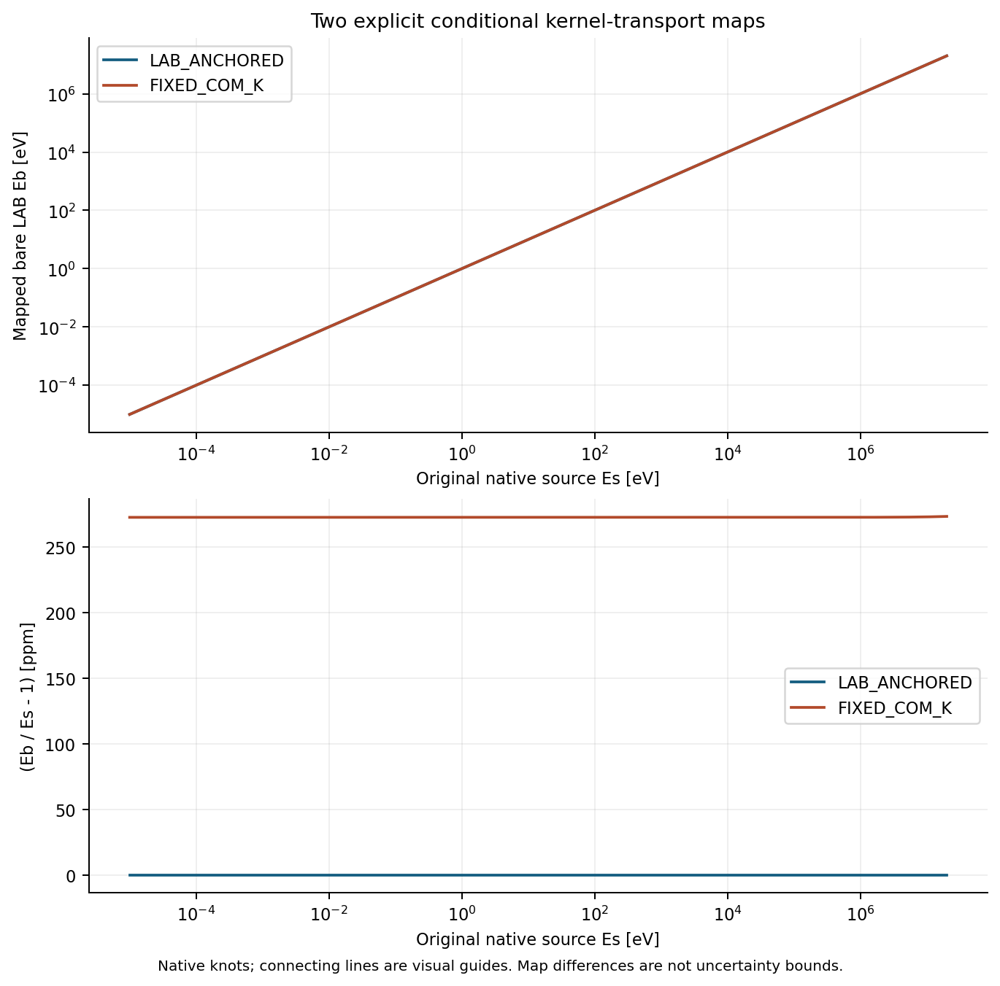
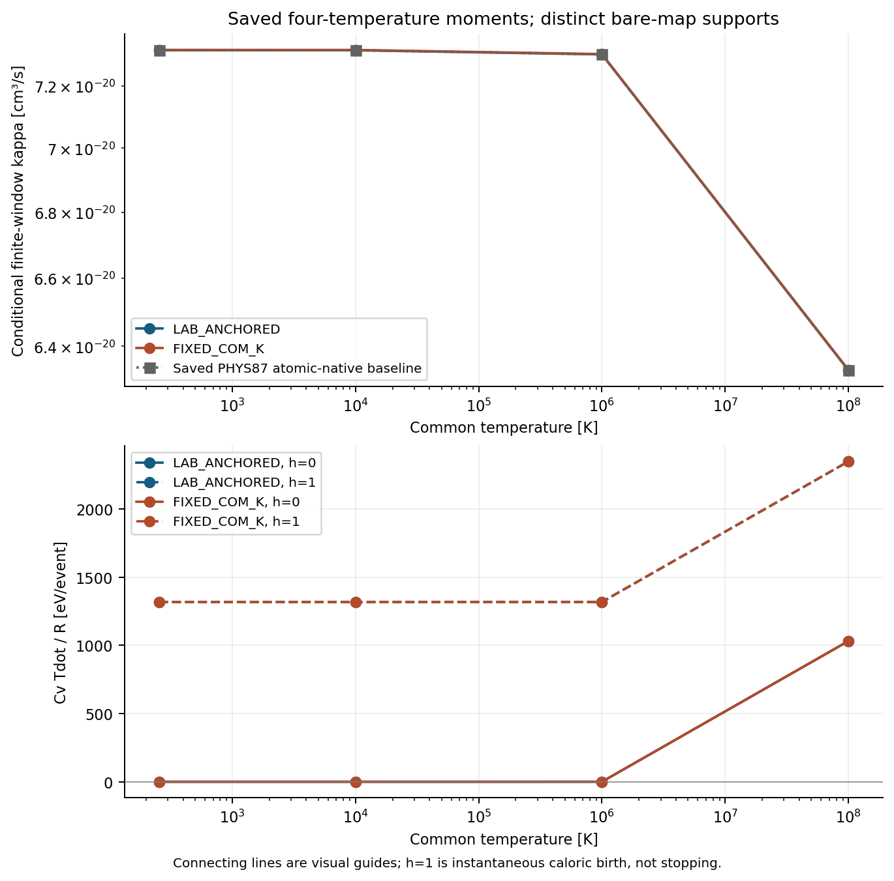

# PHYS88 — atomic-to-bare capture 변환과 조건부 finite-T kernel

## 결론

PHYS87 FINAL `496670cf39b3c2b5ff5e208c01bb135fe96b3780`의 실제 descendant에서, 원 ENDF H1(n,γ) source를 bare n+p→d+γ에 연결하는 **질량 관례·4-vector 재표기·두 조건부 energy 사상·새 bare finite-window 열평균**을 구현하고 실제 계산했다. 완료 범위는 `MASS_CONVENTION_COVARIANT_RELABELLING_AND_CONDITIONAL_BARE_KERNEL`이다. 원 `NUCLEAR_ATOMIC_TO_BARE_CAPTURE_REMAP` 및 `NUCLEAR_PHYSICAL_FINITE_T_EVENT_SUPPLIER` 부모는 PARTIAL이며 실제 nuclear rate/stopping/production을 활성화하지 않았다.

이 보고서의 수치 근거는 [primary RESULT](results/primary001/RESULT.json), [별도 reference](results/INDEPENDENT_REFERENCE.json), [저장 readout](results/SAVED_READOUT_SUMMARY.json), [독립 검토](reviews/INDEPENDENT_REVIEW.json), [root 수용](SCIENTIFIC_ADMISSION.json)이다. Published HEAD와 실제 provider ACK/복원은 별도의 delivery 및 external final/terminal receipt로 판정한다. 이 문서에 미래 전달 성공을 자기참조로 넣지 않는다.

- Scientific identity: `2712595494bd9d784539d470c4ad0b178314c1ca55d2b0b9a75cb5dc1e6a2774`.
- Contract revision3 SHA256: `8f45d6a70d7cf7ffcc556b74636f25087167a3372f781eee4078f5dd00e4154d`.
- Primary RESULT:421150bytes, SHA256 `6f3f1e8d6ce07619502dee8683d8322560fe1c13e70ae27f2eb1381969500104`.
- Independent reference:188804bytes, SHA256 `a9f596de2a0d4a15c4bae1bf83ef74bbd9565c203b92f00fb850ad46eef257aa`.
- 새 primary1완료/실패0, reference1완료, 저장그림1완료. 이전 완료 identity 재실행0, ODE0, benchmark0, network activation0, fast stopping0.

## 1. 실제 최신 결과를 조사해 선택한 연구

[SURVEY_SYNTHESIS_KO](SURVEY_SYNTHESIS_KO.md)에 조사 방법·시점·exact identity·반영 범위를 기록했다. 접근 가능한51repo 목록과2241branch refs를65terminal API pages까지 확인했고, 관련6repo×최근5PR의 실제 본문/head30개 및 선택 원문을 읽었다. 이것은 repo/branch **metadata 목록의 전수 확인**이다. 모든 branch source나 접근 불가 private conversation을 완독했다는 뜻이 아니다. Personal Context는 실제 UNAVAILABLE이었다.

PHYS83 owner completion 및 PHYS78–87 완료 결과는 재사용했다. PHYS82의 최종 CRLF 복구 이후 ancestry를 유지했으며 S2 science commit만 단독 checkout하지 않았다. PHYS87의 원 raw ENDF, table, positive witness, saved baseline과 전체 FINAL archive를 재사용했다. Parent ZIP의 이전 양쪽 wholeGET/CRC562/payload561/Git102/extraction562 검증은 보존하고 반복 실행하지 않았다.

HE shape benchmark, REC represented response, CR finite ground-H1 CE, BASS state/event measure, REI stock/work를 각 owner 범위로 수신했다. S0 직전 중앙2650548, S1 직전3423209의 변경과 양쪽 AGENTS 동일성을 추가 대조했다. REI conditional stock/work20/20은 physical common-measure/history 또는 L4ready를 닫지 않는다. Local-only169lost와 C remote fullGET NOT_RUN도 보존했다.

새 BASS B3C S2 backup은 exact-ID wholeGET1회와 provider content hash를 대조했고160members 중9selected 원문을 읽었다. 이 결과는 manufactured cold/recoil-free atomic Lyα source의 finite14cohort/τ[0,.1] 사례다. New Git ACK는 관측되지 않았다. Proper-clock, photon ownership, newborn midpoint timing은 후속 수신기 설계의 근거이며 PHYS88 nuclear-photon consumer binding은 아니다. 자세한 수신 의무는 [SOURCE_CONSUMER_HANDOFF](theory/SOURCE_CONSUMER_HANDOFF_KO.md)에 남겼다.

## 2. Q 차이와 signed 4-vector 회계

원 source convention을 `h=AWR*a`, `D=a+h−Qs`로 정의하고 bare n,p,d rest energy를 a,b,d로 둔다. 동결 nominal 입력은 `Qs=2224648eV`, `Qb=a+b−d=2224566.37eV`다. NIST CODATA2022 nominal n/p/d/e를 부모와 대조했고 NIST ASD의 H/D ground binding rows를 실제 rendered 원문에서 받았다. 입력과 provenance는 [SOURCE_CONTRACT](source_data/SOURCE_CONTRACT.json)에 결속했다. 표시된 token의 exact rational 관계와 물리 측정값의 정확성을 구별한다.

`ΔH=h−b`, `ΔD=D−d`, `ρH=h−(b+e−BH)`, `ρD=D−(d+e−BD)`로 쓰면 다음 분해가 정확하다.

\[
Q_s-Q_b=\Delta_H-\Delta_D=(B_D-B_H)+(\rho_H-\rho_D).
\]

\[
81.63\,\mathrm{eV}=0.003700036867\,\mathrm{eV}+81.626299963133\,\mathrm{eV}.
\]

81.63eV 전체를 convention residual 또는 gas heat라고 부르지 않는다. H/D 표시 uncertainty는 별도로 보존했지만 covariance가 주어지지 않았으므로 실제 physical CI를 합성하지 않았다.

Metric−+++에서 q=(E,c p)=εU, U·U=−1이다. Source의 같은 사건과 velocities를 bare로 재표기하면 필요한 signed carrier는

\[
C=\Delta_H U_H-\Delta_D U_D,
\qquad \Delta q_{\mathrm{reservoir}}=-C.
\]

이는 normal-frame spatial 성분까지 갖는 convention/internal 회계다. 실제 on-shell electron 또는 thermalization reservoir로 채택하지 않는다. 실제 fixture 중 Es=.0253eV, normal z-boost β=.2, COM photon μ=−1에서는 C≈(−41.0188353,0,0,−603.229550)eV다. C0가81.63이라는 상수를 가지지 않으며,18fixtures의 C0는 약−45772.0611에서554.2506eV까지 변한다. 이 관찰은 signed carrier 식의 유한 fixture 확인이며 전체 연속 boost domain의 수치 certificate는 아니다.

별도의 새 bare 사건은 incoming qn+qp와 bare daughter mass d에서 COM energy Wb를 구성한다. `qb=Qb+Kb`, `Kb=Wb−a−b`라 하면 COM photon/recoil kinetic energy는

\[
e_*={q_b(2W_b-q_b)\over2W_b},\qquad
k_{d*}={q_b^2\over2W_b}.
\]

이 photon/daughter four-vector를 같은 normal frame으로 boost한다. 이미 보존되는 이 새 bare 사건에는 위 재표기 carrier를 더하지 않는다. 상세 유도는 [ATOMIC_BARE_REMAP](theory/ATOMIC_BARE_REMAP_KO.md)에 있다.

## 3. 원 native Es를 보존하는 두 조건부 사상

| 사상 | 고정량 | Native Es→bare Eb | Bare support[eV] |
|---|---|---|---|
| LAB_ANCHORED | target-rest neutron LAB energy | Eb=Es | [1e−5,20000000] |
| FIXED_COM_K | source의 COM excess kinetic energy | Kb=Ks(Es), Eb=Kb(2Mb+Kb)/(2b) | [1.0002723992401612e−5,20005462.392183945] |

두 사상 모두 σ와 angular law는 원 **native Es**에서 평가한다. 새 Eb knot를 만든 뒤 원 INT flag를 재사용하지 않는다. Native-coordinate integration의 Jacobian은 measure에 한 번만 들어가고 cross-section 자체에는 추가하지 않는다. Positive-branch 역변환과 단조성은 exact algebra로 닫았다. 밖의 energy를 clipping하거나0으로 연장하지 않는다.

이 두 가정은 실측 bare kernel에 대한 confidence interval이 아니다. 선택된 energy anchor가 다른 두 명시적 모형이다. 원 angular positivity153knots/152convexcells는 부모의 완료 witness를 재사용했다.

그림의 위 곡선은 전 범위에서 매우 가깝고 아래 ppm표시가 차이를 분리한다. Native knots 사이 연결선은 시각적 보조다.

## 4. 새 finite-T 결과와 물리적 의미

공통T의 등방 classical Jüttner bare n,p에 대해 source support 안의 reaction-selected moments를 계산했다. 새로운 full integral은2maps×4T×GL16/32=16개다. 최고T의 두 central-difference 쌍4scalar를 더해 primary의 총 적분은20개다. Parent PHYS87 integrator는 호출하지 않았다.

| T[K] | κ LAB_ANCHORED[cm³/s] | κ FIXED_COM_K[cm³/s] | COM/LAB−1[%] |
|---:|---:|---:|---:|
|255|7.31699633902533e−20|7.317992836317066e−20|0.0136189393|
|10000|7.316879732309225e−20|7.317876258149629e−20|0.0136195465|
|1e6|7.30319892901106e−20|7.30419726434061e−20|0.0136698362|
|1e8|6.331006282451168e−20|6.332074877186871e−20|0.0168787502|

위 차이는136.189–168.788ppm의 조건부 모형 민감도다. 연속 온도 구간 전체를 검증한 수치 bound 또는 actual source uncertainty가 아니다. 저장 PHYS87 baseline 대비1e8K 변화는 LAB−0.00325971091%, COM+0.01361848910%다. 다른 질량·사상 계약을 비교한 값이며 species-off 인과 실험이 아니다.

최고 온도1e8K에서 normal-frame event당 평균은 다음과 같다.

| 사상 | incoming kinetic[eV] | photon[eV] | daughter kinetic[eV] |
|---|---:|---:|---:|
|LAB_ANCHORED|24820.83706748955|2235144.773597011|14242.433470478587|
|FIXED_COM_K|24821.026008750465|2235144.9623141154|14242.433694635218|

각 행은 `<Eγ>+<Kd>=Qb+<Kin>`을 만족한다.255K에서 photon mean은2223248.744882716eV, recoil mean은1317.691039959829eV다. 저장 source-convention photon mean과의 차이는255K에서−81.89175714eV이고,1e8K에서 LAB−82.08015417eV, COM−81.89143706eV다. Q 차이만 photon 또는 heat에 더하는 처리는 recoil과 반응 선택을 놓친다.

Thermal/fast owner는 h=0/1로 분리했다. Event당 thermal count는 h−2, fast count는1−h, free electron 변화는0이다. Thermal energy는 `h<Kd>−<Kin>`, fast energy는 `(1−h)<Kd>`, nuclear rest 변화는−Qb, atomic binding 열은0이다. Photon은 handoff 또는 escape의 한 route만 차지한다. 총32owner rows를 저장했다.

입자 수가 변하는 gas의 caloric source는 다음이다.

\[
{C_V\dot T\over R}
=-\langle K_{in}\rangle+u_n+u_p+h(\langle K_d\rangle-u_d).
\]

1e8K LAB에서 h=0은 thermal kinetic energy 약−24.8208keV/event를 제거하지만 `Cv*Tdot/R`은+1031.459301eV/event다. 선택된 반응물의 에너지와 제거되는 thermal 입자 수를 함께 계산하기 때문이다. h=1이면2347.818645eV/event다. 반면255K의 h=0은 약−7.69e−8eV/event로 아주 작게 음수다. 모든T에서 양수라고 요약하지 않는다. h=1은 즉시 caloric birth 가정이며 실제 daughter stopping을 실행한 결과가 아니다.

이 고정T source/readout을 coupled thermal/xe/geometry history의 경계로 쓰지 않는다. 전체 history·radiation transport·stopping은 새 수신 계약 이후의 별도 의무다.

## 5. 실제 검증과 독립성

| 항목 | 실제 결과 | 동결 기준/범위 |
|---|---:|---|
|Primary assertions|482/482 PASS|36guard 포함; 별도 추가482+36으로 합하지 않음|
|Native raw/table fields|별도parser612/612|153rows, 원 ENDF raw/tableSHA 동일|
|GL16/32 최대 상대차|2.0945082658e−16|네T×두map의 rate와3means,≤1e−8|
|FD 로그미분 최대 절대차|6.2714039045e−8|최고T, hlog=2^-8,≤5e−7|
|Source relabel 최대4component residual|4.7148205340e−7eV|18fixtures,≤3e−6eV|
|Bare4vector 최대 scaled residual|1.5652299798e−16|36fixtures, S4로 정규화,≤2e−15|
|Mass shell 최대 scaled residual|2.7903886301e−16|계약의 양의 E²+p²+ε² 척도,≤3e−15|
|Mean/owner energy 최대 절대 residual|7.6443029684e−10eV|≤2e−7eV|
|Map knot roundtrip 최대 상대차|4.0421986745e−16|153knots/map,≤3e−15|
|Independent8fields 최대 상대차|4.2887098120e−13|별도parser/SciPy kve/adaptivequad,≤1e−7|

Independent reference는 production integrator를 import하지 않았고 최고T에서 두map×rate+3means를 별도 reduction으로 계산했다. 실제1216quad calls/25620callbacks다. 미지 tail·covariance·physical source CI 검증으로 확대하지 않는다. Signed energy accounting, sampled quadrature와 machine residual은 continuum certificate가 아니다.

C9에서 moments PDF가21400bytes에서4928bytes로 짧아진 불일치를 발견했다. 원인NOT_ESTABLISHED와 짧은 원본을 보존했다. 별도 한정 artifact recovery child1회에서 저장된 해당 그림만 다시 구성했고 PNG메모리pass의 SHA가 원PNG와 일치했다. PDF자체는21400bytes로 닫혔으나 예상 timezone token guard에서exit1이 발생했다. 이 최초실패와 비용을 보존한 뒤, 이미 생성한 PDF의 관측된−19 timezone token을 원자료의−05 token으로 같은 길이의 metadata bytes만 교체했다. 추가render0으로 원PDF SHA638936…가 정확히 복구되었다. 닫힌 staging/파일 및 directory fsync/atomic placement/reopen 후 네그림 모두 원FIGURE_RECEIPT와 일치한다. 원frozen source/receipt/primary/reference는 변경하지 않았다. 이는 과학 재실행이 아니라 한 파일의 전달 무결성 복구다.

Actual resume은 SKIP이며 scientific callbacks0, integrations0, rewrites0이다. 여섯 primary payload의 before/after bytes와 SHA가 모두 동일하다. 그림은 saved-only child1회에서2PNG+2PDF로 만들었으며 root와 independent reviewer가 두 PNG를 실제로 확인했다. 완료된 과학 identity 재실행은 없었고 위의 추가 affected-PDF 복원만 별도로 계상했다.

Wolfram actual calls는2회다. 첫 call의 JSON exporter 실패를 보존했고 명시적인 diagnostic recovery1회로18scalar exact zeros를 받았다. 출력의 `all_zero=False`도 보존했다. 미단순화 COM inverse와 monotonicity는 양의 principal-root branch를 사용하는 별도 수기 증명과 독립 검토로 닫았다. CAS가 모든 항을 자동0으로 반환했다고 쓰지 않는다. 상세 raw와 최초실패는 theory/reviews에 있다.

## 6. 구현·실행 자원·누적 예산

`source/atomic_bare_remap.py`는 exact nominal mass identity, 두사상, signed relabel carrier, fresh bare event, stable scaled-Bessel thermal moments, disjoint owner를 구현한다. `run_primary.py`는 create-only primary001과 identity 검증을, `leased_call.py`는 원 PHYS78 gate 전체 SHA를 고정한 fresh lease/resource admission을 담당한다. 독립 reference와 saved plot은 별도 파일이다. Runtime 버전은 metadata이며 완료 identity를 자동 재실행하는 이유가 아니다.

| 실제 child | CPU[s] | Launch-inclusive wall[s] | CPU/wall cap[s] |
|---|---:|---:|---:|
|Primary|0.180113|0.181474277000234|24/60|
|Independent reference|0.838988|0.840593552002247|30/60|
|Saved figures|3.348951|3.35081246199843|8/30|
|원 계획3child 합계|4.368052|4.372880291000911|원 한정 단위|
|추가 affected-PDF 복구 child(exit1 보존)|2.954885|2.958114809000108|8/30 별도 명시적 artifact amendment|
|전체4child 합계|7.322937|7.330995100001019|과학 primary/reference 실패0; artifact child실패1 보존|

원3child coordinator CPU는0.069093s이고 artifact 복구까지 포함하면0.091635s다. Metadata-only closure의 별도 CPU는0.0005106s, wall은0.001375430s다. 각 child는 원 공유 lease를 새로 획득했고 own lease를 반환했다.1worker/thread, scientificCPU0/coordinatorCPU8을 실제 기록했다. 원3child fresh available memory의 최솟값2,292,404,224bytes는1.5GiBreserve+0.5GiBjob=2,147,483,648bytes 이상이었다. 복구 child도fresh available2,243,858,432bytes 및 같은 원gate를 통과하고 ownlease를 반환했다. 다른 process를 종료하지 않았다.

Known PHYS87+88 local-child CPU 부분합은 원계획만8.732435s, 실제 artifact 복구를 포함하면11.687320s다. 전체 과거 비용이나 남은 예산으로 부르지 않는다. PHYS85/86 symbolic4+PHYS87symbolic1+PHYS88symbolic2의 lineage7calls를 보존했다. 이번 primary/reference/원figure 잔여 child 허용량은각0, symbolic 잔여0이며, 별도 승인된 affected-artifact child1회도 잔여0이다. 기존 allowance를 초기화하지 않았고 budget_reset=false다. 전체 historical/remote CPU·금액·잔액의 미관측값은null이다. 외부 BASS/REI owner 비용도 이번 비용·허용량으로 옮기지 않는다.

## 7. 게시·백업·진척률을 분리한 판정

| Checkpoint | 한정 루프 단계 수 | 실제 게시/전달 판정 위치 |
|---|---:|---|
|S0 source/theory|9/20(45%)|HEAD0528ca635c12;delivery/S0_DUAL_ACK.json|
|S1 code freeze|11/20(55%)|HEADe9b7b78041fb;delivery/S1_DUAL_ACK.json|
|S2 science/review|18/20(90%)|실제 S2 commit과delivery/S2_DUAL_ACK.json; 미리 ACK로 표기하지 않음|
|FINAL delivery|최종의무 완료 후20/20|외부 final/terminal receipt의 양쪽wholeGET/전체복원/JSON readback/DAG·PR확인|

R1–R10/C1–C10의 실제 상태는 [RESEARCH_LOOP_MAP_KO](RESEARCH_LOOP_MAP_KO.md)와 [STAGE_PROGRESS](STAGE_PROGRESS.json)에 있다. Workflow R10과 물리 HH_R10은 다른 이름공간이다. 전체 물리목표의 가중치·완료 정의가 없으므로 globalcompletion=null이다.

S0/S1/S2의 실제 upload ACK 및 exact-ID metadata는 최종 전체 복원과 다르다. 최종본은 양쪽 실제 전체 다운로드·원본byte/SHA·CRC·payload SHA·remote owned Git blob identity·실제 추출을 확인하고, 외부 JSON도 원문을 내려받아 identity/SHA를 대조한다. 완료 여부는 실제 external receipt에서 읽어야 한다. 완료된 science를 전달을 위해 재실행하지 않는다.

최초 metric표기와 residualscale 지적, symbolic exporter 실패 및 제한된 복구, source HTTP403, publication 준비의 historical promisor-blob 접근 실패, BASS backup namespace lookup 교정도 이력으로 보존했다. 구체적 문제가 해결된 후 같은 선택의 불필요한 재검토·재실행은 하지 않았다. 과학 수치 tolerance나 원sourcebytes는 완화·변경하지 않았다.

## 8. 다음 DAG와 남은 물리 의무

완료 재사용 순서는 `WU_CE83_OWNER_COMPLETION` → PHYS85 thermal/fast ownership → PHYS86 finite-T reaction-selected moments → PHYS87 native finite-window source → PHYS88 conditional bare remap child다. 다음 단일 노드는 **NUCLEAR_BARE_KERNEL_SOURCE_AND_CONSUMER_CONTRACT**다. 먼저 원전의 실제 bare/atomic source/charge-state validity·지원 energy범위/uncertainty와 named thermal/fast/radiation consumer의 measure/ownership을 닫는다. 이후에만 실제 nuclear rates·fast stopping의 활성화를 검토한다.

병렬 OPEN으로 HE_LI_CX_STATE_AND_PHOTON_ENERGY, Li instrument/deconvolution/isotope/target-state/physical uncertainty, RECOMBINATION_TO_Z20_INITIAL_CHARGE_CONTRACT, D_PI_RR_MATCHED_SOURCE_MOMENTS, LI_HARD_UV_INNER_SHELL_SPECTRAL_CONTRACT, FULL_GEOMETRY_SPECTRAL_BACKREACTION을 유지한다. PHYS82 Li 조건부 model범위를 actual source confidence interval로 쓰지 않고 fixed-T/ne exposure를 coupled history의 bound로 쓰지 않는다.

Non-tilted LRS BianchiI, reacting gasπ=0, collisionless DMπ_m별도다. 같은 normal orthonormal frame의 signed matter/radiation tensor를 먼저 합한 뒤 norm을 취한다. Frobenius=√2×half-contraction norm이다. HH_R10=OFF, production admission NOT_ISSUED, main merge0을 유지한다.
