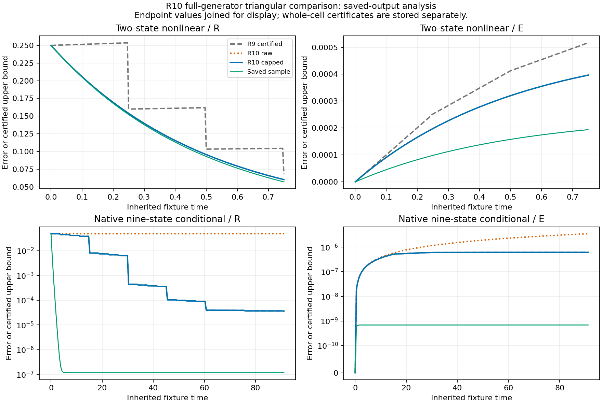

# WU088_HH molecular R10 — full-generator triangular 오차 상계

## 1. 결과와 채택 범위

이번 연구 단위는 `WU_FULL_GENERATOR_TRIANGULAR_R10`이다. 기존 R9의 저장 입력과 결과를 보존하면서, HD 잔차 방정식의 projected sink를 보존적 생성자에 포함하는 이론을 유도하고 정확한 바깥쪽 반올림으로 구현했다. 독립 심사 `PASS_SCOPED_FINAL_C9`, 열린 중대 지적 0건에 따라 이론 노드와 코드 노드를 각각 하나씩 채택했다. 과학 DAG는 **19/34 → 신규 두 노드 등록 19/36 → 채택 21/36**이다. 기존 34개 노드 객체는 구조적으로 동일하다.

과학 채택 source는 [`a2c62aaad2396d1720a12e74774e52374baa4c33`](https://github.com/cosmosapjw-quantum/WU088_HH/commit/a2c62aaad2396d1720a12e74774e52374baa4c33), tree는 `0d96679316dad312a22e07e4d3e4028a715e323c`다. 41개 파일로 구성한 과학 payload의 SHA-256은 `57ee9ad49afbd1a492914fadba480ed787b51e4bcefc8c0be62c31e196590fff`다. 정확한 파일별 크기·해시와 집계 직렬화 규칙은 [SCIENTIFIC_PAYLOAD_MANIFEST.json](SCIENTIFIC_PAYLOAD_MANIFEST.json)에 있다. 뒤의 보고서·인계·게시 영수증 변경은 이 과학 payload를 변경하지 않는다.

이번 결과는 고정된 계수, 인증된 전체 영역, 같은 source family·상태 순서·시계라는 전제 아래의 **조건부 방법론 채택**이다. 실제 HD reactive array와 물리 consumer·밀도·시계의 연결은 여전히 `INPUT_PENDING`이다. `HH_R10=OFF`, `production=NOT_ISSUED`, `L4_ready=false`, 물리 및 중앙 DAG 증가분 0을 유지한다. 여기서 기존 물리 게이트 `HH_R10`과 이번 molecular R10 연구 차수는 서로 다른 식별자다.

핵심 근거는 [채택 기록](SCIENTIFIC_ADMISSION.json), [전체 증명](theory/PROOF_KO.md), [정리와 API](theory/THEOREM_AND_API_KO.md), [독립 최종 심사](reviews/C9_FINAL_REVIEW.json), [수치 결과](RESULTS_KO.md)다.

## 2. 최신 repo·브랜치·백업·대화 조사

### 2.1 최초 전체 census

2026-10-28 **08:45:36–08:45:45 KST**에 접근 가능한 51개 저장소의 2,375개 branch head를 65페이지로 조사했다. 51개 저장소 모두 마지막 페이지까지 확인했고 해당 census 실패는 0건이다. 공개 저장소는 35개·1,892 heads·47페이지, 비공개 저장소는 16개·483 heads·18페이지다. 비공개 내용은 공개 산출물에 포함하지 않고 집계 수치만 남겼다.

이전 R9 공개 census와 비교하면 신규 ref 2개, 이동 2개, 삭제 0개, 불변 1,888개다. WU 자신의 R9 진행으로 인한 head 이동을 외부 신규 과학 입력으로 세지 않았다. 관련 7개 저장소의 최신 PR metadata 35행과 변경 owner source 6개를 읽었고, 해당 72,409 bytes는 원격 Git blob 6/6과 일치했다. 근거는 [초기 종합](authority/intake/SYNTHESIS_KO.md), [공개 census](authority/intake/PUBLIC_CENSUS.json), [source manifest](authority/intake/SOURCE_MANIFEST.json)에 있다.

다른 대화의 전체 원문을 조회하는 personal-context 요청은 실제로 `Personal context is unavailable for this conversation`이라는 오류를 반환했다. 따라서 **다른 대화 전체 원문 회수는 0건**이다. Git에 게시된 handoff·보고서·PR 본문은 읽었지만 이를 전체 대화 열람으로 표현하지 않는다. [대화 접근 기록](authority/intake/CONVERSATION_ACCESS.json)에 한계를 보존했다.

### 2.2 종료 시점의 지정 7개 ref 변경

최초 조사 이후 **09:28:53 KST**에 관련 owner의 지정 7개 ref만 다시 확인했다. 3개 이동, 4개 불변, HEAD GET 오류 0건이었다. 변경된 immutable source의 읽기는 **09:32:02 KST**에 끝냈다. 이 후속 조사는 51개 저장소 전체 census를 갱신한 것으로 해석하지 않는다.

| owner | 종료 snapshot | 확인한 상태와 WU에 대한 의미 |
|---|---|---|
| BASS B3h restart | `f834101d3292f304681349db5d435c6f0c6b559e` | 수행·게시·백업 각각 18/20. distinct-author R6/C9는 NOT_RUN. 새로운 native ODE 실행은 0. |
| REI finite thermal | `e77bc7ec48ae2aee8ded573e66ac0a1060017c54` | 이론 5/10, 코딩 설계 4/10, 합계 9/20. 문서 5개에 10 provider ACK. 실제 EOS/온도 갱신과 구현·수치 검증은 미완. |
| CR He event union | `e91a0d19b13a0b3254c194e7a4863b845c271874` | 새 `CR_PHYS02_HE_EVENT_UNION_V1` 계약·조건부 consumer 설계가 추가됨. 수행 14/20, 이 snapshot에서 dual-backup receipt는 13/20까지 확인. |
| REI central | `22a99cb9b1691274e74c122d54521be4f2f51ba5` | 불변; 기존 근거 재사용. |
| BASS_HE AZIMUTH09 | `307fee38cb65b957deea84c3308f59e972049362` | 불변; 기존 근거 재사용. |
| REC weighted bridge | `6fdf2cca545d9b44d0666bc22a3233a675e5ad03` | 불변; 기존 근거 재사용. |
| Vigil production closure | `7eb2dd0ffda39afb2871d76700a720986ff09fe0` | 불변; 기존 근거 재사용. |

CR의 새 조건부 결과는 고정 He marginal에 대한 sharp envelope

\[
0\le C_{\rm cross}\le\min\left(N/2,\;N-\max_i n_i\right)
\]

와 same-state source-ion union consumer 설계다. C4 probe receipt는 PASS, measured CPU 0.114369 s, charged CPU 0.164369 s이며 `scientific_status`는 null이다. 최초 census 때의 “기존 commit을 가리키는 alias” 관찰은 그때의 상태이고, 종료 snapshot에는 실제 새 작업이 있다. 다만 exclusive He event measure, 실제 cross correction, outside partner response, proton donor debit, 실제 EOS/T 및 full-source physical native25는 여전히 null이다. 조건부 CR consumer의 존재를 실제 WU HD consumer 연결로 승격하지 않았다.

이번 지정 ref 조사에서 실제 HD 반응 배열 또는 실제 WU consumer binding의 신규 전달은 관찰되지 않았다. 이는 모든 대화·repo·백업에 해당 입력이 없다는 전역 부재 판정이 아니다. WU의 동결된 R7 입력을 변경한 근거가 없으므로 현재 R10 실행 결과도 자동 무효화되지 않는다. 상세 원문·immutable URL·projection 여부는 [종료 조사](authority/closeout_delta/CLOSEOUT_SUMMARY_KO.md)와 [source manifest](authority/closeout_delta/SOURCE_MANIFEST.json)에 있다. 성공한 source read 14개 중 11개는 원격 Git blob과 같고, 3개 receipt는 경로를 제거한 공개 projection이다. BASS `AGENTS.md`의 단일 404는 source-read 실패로 별도 기록했다.

### 2.3 백업과 첨부의 실제 범위

Dropbox 관련 dossier subtree는 5,193개 고유 항목을 9페이지로 끝까지 조사했다. WU 하위 항목 610개, CR 206개다. Drive의 WU 폴더 642개와 CR 폴더 188개를 확인했다. Drive 전체 과거 dossier는 1,000개 제한 때문에 **부분 조사**이며, 별도 문서 검색 927개·3페이지와 폴더 27개를 끝까지 확인했더라도 전체 과거 ZIP 목록이 완전해지는 것은 아니다.

이전 R9 초기 cutoff 이후의 대응 파일 23쌍은 이름과 크기가 23/23 일치했다. 이 중 WU R9 11쌍, HE 11쌍, CR 1쌍이다. 이들은 23개의 새로운 과학 입력이라는 뜻이 아니다. 초기 조사 시점에 R9 FINAL cutoff 이후 새 파일은 0개였다. 이후 이번 R10에서 직접 만든 단계별 백업은 별도로 아래에 기록한다.

현재 20개 첨부는 R7 manifest와 크기·SHA-256이 20/20 일치했다. 기존 archive member metadata 60,882개와 PDF text 15개의 조사 근거를 재사용했고, 새 압축 해제·OCR은 수행하지 않았다. R9의 원본 다운로드 22건 해시 검증도 기존 완료 근거를 재사용했다. 이번 새 백업의 provider ACK·크기 확인을 R9 수준의 원격 원본 재다운로드로 표현하지 않는다. [백업·첨부 종합](authority/backup_literature/INTAKE_SUMMARY_KO.md)을 참조한다.

## 3. 문헌과 연구 질문

Exa 검색 3회와 source fetch 3회, SciSpace 검색 3회·30행을 실제 사용했다. 무관한 검색 결과는 채택하지 않았다. Gaubert–Qu의 [Dobrushin 논문](https://arxiv.org/pdf/1307.4649)의 식 (1)–(2), Theorem 6.2, Example 6.3을 확인했다. 이 논문이 제공하는 기존 stochastic contraction 계수를 열 보존 생성자 관례로 옮기고, 연속시간 및 HD projected-sink 결합은 이번 증명에서 직접 연결했다. 일반 Dobrushin 정리의 신규성을 주장하지 않는다.

Michel–Siegle의 [CTMC aggregation 논문](https://arxiv.org/html/2403.07618v2), Section 3.2 Theorem 4는 초기 오차와 defect forcing의 분해를 비교하는 출처로 읽었다. Hilder–van Meurs–Sharma의 [2026년 논문](https://arxiv.org/html/2602.17579v1)은 이번에는 초록·서론·초기 정의까지만 읽었고, 읽지 않은 정리나 상수를 이식하지 않았다.

HD reactive source는 González-Lezana, Hily-Blant, Faure의 [JCP 157, 214302 (2022), DOI 10.1063/5.0128598](https://doi.org/10.1063/5.0128598)를 확인했다. 반응성 state-to-state 자료에 대한 supplement 안내와 nonreactive HD excitation에 관한 EMAA 안내를 구별했다. 실제 reactive array bytes의 회수는 0이며, Digital CSIC 항목은 locator로만 남겼다. 저자명에 대한 초기 계획상의 축약 오류도 정정했다. 읽기 범위와 source별 채택 역할은 [LITERATURE.json](authority/backup_literature/LITERATURE.json)에 있다.

선택한 질문은 “기존 입력에서 반응의 projected sink를 단순한 증폭 forcing으로 처리하지 않고, 보존적 혼합 생성자에 포함하면 오차 상계를 줄일 수 있는가?”다. 이 질문은 실제로 유도하고 구현할 수 있고, 저장된 R7–R9 증거를 재실행 없이 비교할 수 있다. 물리 입력을 새로 확보했다고 가정하지 않았다.

## 4. 이론 유도

### 4.1 정확한 잔차와 생성자

HD fine-state population을 \(x\), 총량을 \(X=\mathbf1^\top x\), simplex lift를 \(\pi\)라 하고

\[
r=x-\pi X,\qquad \mathbf1^\top r=0,\qquad R=\|r\|_1
\]

로 둔다. 공유 불변량이 같은 coarse 차이는 \((-\eta,-\eta,\eta,\eta)\)로 쓸 수 있으며 \(E=|\eta|\), coarse \(\ell^1\) 오차는 \(4E\)다.

\(K\)는 열합 0의 Metzler 생성자, 미시적 파괴율 벡터는 \(\boldsymbol d\ge0\), \(D=\operatorname{diag}(\boldsymbol d)\)다. 정확한 잔차 방정식에서

\[
H_\pi=\pi\boldsymbol d^\top-D,\qquad A(t)=K+w(t)H_\pi
\]

를 정의하면

\[
r'=A(t)r+qX+k_fuv(\alpha-\pi)
       -wX\left(D\pi-\pi\boldsymbol d^\top\pi\right),
\qquad q=K\pi-\dot\pi.
\]

\(H_\pi\)의 비대각 성분은 \(\pi_i d_j\ge0\), 열합은 0이므로 \(w\ge0\)에서 \(A\)도 보존적 Metzler다. 이 부호·보존 구조를 쓰는 것이 핵심이다. 임의의 비선형계에서 양의 feedback 항을 삭제하는 규칙을 제안한 것은 아니다.

### 4.2 Zero-sum 수축률

열 생성자의 순간 수축률은

\[
\lambda(A)=\min_{i<j}\left[
A_{ij}+A_{ji}+\sum_{k\ne i,j}\min(A_{ki},A_{kj})\right].
\]

작은 \(h\)에서 \(I+hA\)는 stochastic이고 Dobrushin 계수는 정확히 \(1-h\lambda(A)\)다. Zero-sum 양·음 질량 분해와 Dini/product-integral 논증으로

\[
\|U_A(t,s)r\|_1\le
\exp\left[-\int_s^t\lambda(A(u))\,du\right]\|r\|_1
\]

를 얻는다. \(H_\pi\)의 pair overlap은

\[
L_{ij}(H_\pi)=\pi_i d_j+\pi_jd_i+
(1-\pi_i-\pi_j)\min(d_i,d_j),
\]

이므로 \(\lambda(H_\pi)\ge\min_i d_i\)다. 고정 \(K,\pi,\boldsymbol d\)와 인증된 \(w\in[m_w,M_w]\)에서 각 overlap은 \(w\)에 대해 비감소하므로

\[
\lambda_* = \lambda(K+m_wH_\pi),\qquad
\lambda(K+wH_\pi)\ge\lambda(K)+w\lambda(H_\pi)
\]

를 쓸 수 있다. 시간에 따라 \(K,\pi,\boldsymbol d\)까지 변하는 적용에는 해당 전체 family의 uniform bound가 별도로 필요하다. 구현은 고정 계수 영역을 인증한다. \(n=1\)에서는 zero-sum 공간이 영벡터 공간이므로 기록상의 convention으로 \(\lambda=0\)을 쓴다.

### 4.3 삼각 비교계와 해

원래 R7의 전체 fine/coarse 불변 영역에 유효한 forcing 상계 \(g_r\)를 유지하면

\[
D^+R\le-\lambda_*R+g_r,\qquad
D^+E\le cR+d_cE+g_e
\]

를 얻는다. 종전 비교계의 양의 \(aR\), \(bE\)를 별도 추가하지 않아도 된다. 이는 정확한 HD 잔차와 전체 fine-domain forcing을 함께 사용한 결과다. \(d_c\)는 signed coefficient로 유지한다. 상속된 물리 HD fixture에서는 \(d_c\le0\)이고, 구현 검증은 양의 \(d_c\)도 포함한다.

\(a=-\lambda_*\), \(b=d_c\)에 대해

\[
\phi(a,t)=\int_0^t e^{as}\,ds,\quad
J(a,b,t)=\int_0^t e^{b(t-s)}e^{as}\,ds,\quad
Q(a,b,t)=\int_0^t e^{b(t-s)}\phi(a,s)\,ds
\]

로 정의하면 이상적 비교해는

\[
\bar R(t)=e^{at}R_0+\phi(a,t)g_r,
\]
\[
\bar E(t)=e^{bt}E_0+cJ(a,b,t)R_0+cQ(a,b,t)g_r+\phi(b,t)g_e.
\]

이 적분 정의는 \(a=0\), \(b=0\), \(a=b\)에서도 정칙이다. 예를 들어 \(\phi(0,t)=t\), \(J(a,a,t)=te^{at}\), \(Q(0,0,t)=t^2/2\)다. 독립 reference는 이 scalar analytic form과 극한을 사용한다.

기존 \(K\)만의 유한시간 block 수축률을 full \(A\)의 수축률로 그대로 옮기지 않았다. 증명의 reset-chain 반례는 그 무조건 이식이 성립하지 않는 특정 반례이며, 어떤 가능한 개선도 불가능하다는 strong no-go가 아니다.

## 5. 구현과 독립 검증

생산 구현은 [src/full_generator_triangular.py](src/full_generator_triangular.py)의 세 API다.

```python
generator_certificate(K, pi, destruction, w_box, *, binding)
flow_interval(lam, c, d, g_r, g_e, delta,
              *, whole=False, bits=128, degree=96)
sweep(K, pi, destruction, w_box, c, d, g_r, g_e, delta,
      initial, cells, *, binding, whole_caps=None, point_caps=None,
      bits=128, degree=96)
```

정수·정확한 유리수 문자열·`Fraction`을 받으며 float와 bool은 거부한다. 영역은 상태 1–13개, 셀 1–192개, 입력 scalar 최대 8,192 bit, dyadic 128 bit, Taylor degree 96, shifted scaled infinity norm 16 이하로 고정했다. 생성자의 열합과 부호, simplex, binding의 상태 순서와 시계, cap의 정확한 원본 SHA·JSON pointer·grid를 검사한다. 외부 whole-domain box 자체의 과학적 타당성은 명시적인 입력 전제다.

비교계의 augmented matrix

\[
M=\begin{pmatrix}-\lambda_*&0&g_r\\c&d_c&g_e\\0&0&0\end{pmatrix}
\]

에 \(\sigma=\max(\lambda_*,-d_c,0)\)를 더하면 \(M+\sigma I\ge0\)다. 양의 Taylor 급수의 각 항을 내림·올림하고 geometric tail을 더한 뒤, \(e^{-\sigma\delta}\)의 reciprocal enclosure를 곱한다. 따라서 부동소수점 결과를 임의로 조금 늘린 것이 아니라 정확한 정수·유리수 연산으로 endpoint enclosure를 만든다.

닫힌 셀 전체에는

\[
M_+=\begin{pmatrix}0&0&g_r\\c&\max(d_c,0)&g_e\\0&0&0\end{pmatrix}
\]

의 단조 flow를 사용한다. 이것이 \(M\)을 성분별로 지배하고 비음수 상태에서 단조이므로 셀 끝의 majorant가 그 셀 전체를 덮는다. DOC01은 이 실제 `Mplus` 구현과 증명 사이의 연결 문단을 명시하여 동결 전에 종결했다.

`raw`의 lower 배열은 **이상적 비교해의 lower**이며 실제 물리 오차의 lower가 아니다. `capped`는 같은 clock·cell에서 유효한 기존 R9 upper와 최솟값을 취하고 lower를 반환하지 않는다. 저장된 ODE 표본을 cap으로 사용하거나 point cap을 보간해 whole-cell cap으로 만들지 않았다.

| 실제 검증 | 결과 | 실행량과 범위 |
|---|---:|---|
| 실행 전 동결 | 14/14 파일 크기·SHA-256 일치 | Python AST 4/4 포함; 실행 후에도 동일 |
| Primary | 175/175 PASS, 실패 0 | 1회, OS CPU 0.313979 s, wall 0.314723429 s |
| 독립 reference | 469/469 PASS, 실패 성분 0 | 1회, 9,860 성분 비교, OS CPU 0.197907 s, wall 0.198722822 s |
| Wolfram | 15/15 zero residuals, `all_zero=True` | 1회, 30 s 제한, 경고를 포함한 qualified corroboration |
| 독립 R6/C9 | `PASS_SCOPED_FINAL_C9` | 한 번의 bounded pass를 source→실행 결과→주장까지 이어 수행, 열린 중대 지적 0 |

두 Python 실행의 **전체 OS CPU 합계는 0.511886 s**이며 import와 serialization을 포함한다. 이는 CAS·조사·문서 작성 또는 전체 역사 CPU의 합계가 아니다. Primary와 reference의 사전 한도는 각각 CPU 60 s, wall 90 s였다. 각각 한 번만 실행했고 timeout은 없었다. 이전 과학 실행 재수행과 신규 ODE 실행은 모두 0이다.

Reference는 생산 코드를 import하지 않는다. 정확한 stochastic Euler column 차이로 생성자 계수를 독립 계산하고, unshifted scalar analytic flow를 Decimal 160자리로 평가했다. \(d_c+\lambda_* = \pm10^{-30}\) 근처에서 닫힌 식의 상쇄가 크게 증폭될 수 있어 160자리와 상대 guard \(10^{-80}\)를 **실행 전에** 고정했다. 4개 HD fixture의 192셀·193시점과 9개 analytic control을 검사했다. 9,860은 성분 비교 수이며 독립 물리 시나리오 수가 아니다.

## 6. 실제 수치 결과와 남는 보수성

아래 값은 저장된 정확한 상계를 표시용 실수로 변환한 최종 시점 결과다. 감소율은 같은 R9 인증 상계에 대한 감소율이다. 모든 실험의 시간·밀도는 상속된 조건부 fixture 관례를 유지한다.

| 사례 | R9 최종 R | R10 capped R | R 감소율 | R9 최종 E | R10 capped E | E 감소율 |
|---|---:|---:|---:|---:|---:|---:|
| 2상태, 무반응 | 0.06103515625 | 0.0557825400371 | 8.6058864% | 0 | 0 | 해당 없음 |
| 2상태, 비선형 반응 | 0.0678043993242 | 0.0602119158660 | 11.1976266% | 0.000516508447396 | 0.000396434054403 | 23.2473241% |
| 2상태, coarse source defect | 0.0678051452369 | 0.0602119158660 | 11.1986035% | 0.000685196005486 | 0.000565120788970 | 17.5242143% |
| 저장 native 9상태, 조건부 반응 | 0.0000364476161178 | 0.0000364476161178 | 0% | 0.000000619120080246 | 0.000000619079240657 | 0.0065963923% |

2상태 사례의 \(\lambda_*\)는 무반응에서 2, 반응 사례에서 2.002다. Native 9상태는 \(\lambda(K)=0\), \(\lambda_*=2.085393203227482\times10^{-7}\)이다. Sparse \(K\)의 순간 overlap은 여러 transition을 거친 유한시간 혼합을 충분히 잡지 못한다. 따라서 native raw 최종 R은 약 0.0487007749553으로 기존 R9보다 훨씬 크다. 반응을 full generator에 넣는 정확한 구조적 개선이 모든 입력에서 더 강한 수치 bound를 보장하는 것은 아니다.

| 정확한 성분 비교: R10 대 R9 | 더 작음 | 동일 | 더 큼 | 전체 |
|---|---:|---:|---:|---:|
| raw endpoints | 963 | 200 | 381 | 1,544 |
| raw whole cells | 963 | 193 | 380 | 1,536 |
| capped endpoints | 1,156 | 388 | 0 | 1,544 |
| capped whole cells | 1,343 | 193 | 0 | 1,536 |

Native capped 최종 상계도 저장된 표본 오차보다 R 약 310.953728배, E 약 906.981311배 크다. 물리적으로 충분히 날카로운 closure를 확보했다고 판단할 수 없다. 반면 2상태 비선형 사례의 같은 비율은 R 약 1.056868, E 약 2.043464다. 이것이 현재 방법의 성과와 한계를 구별해 주는 실제 증거다.

Ideal comparison interval의 최대 폭은 약 \(6.271556235224609\times10^{-35}\)다. 이는 정확한 비교해를 둘러싼 수치 interval 폭이며, 실제 물리 오차 상계의 보수성이 이 정도라는 뜻이 아니다.

저장된 no-reaction 표본 하나는 상계를 \(4.0013206434938575\times10^{-12}\) 초과했다. 해당 시점의 고정 허용오차는 \(4.377656370786352\times10^{-11}\)이므로 사전 기준은 통과했다. 따라서 저장 표본의 포함 판정은 **허용오차를 적용한 판정**이다. 정확한 연속시간 상계 정리와 수치 ODE 표본의 엄밀한 포함을 혼동하지 않는다.



그림은 저장 출력만 읽어 만들었다. Endpoint 연결선은 시각적 안내이며, 셀 전체 인증은 JSON의 `whole_cells_upper`에 별도로 있다. Native 패널은 symlog 축을 사용한다. 그림과 표의 원자료는 [RESULT_ANALYSIS.json](raw/RESULT_ANALYSIS.json), 후처리 코드는 [analyze_saved.py](verification/analyze_saved.py)다.

## 7. 실제 실패·경고·수정의 보존

Wolfram은 15개 잔차 0을 반환했지만 `Infinity::indet`, `Power::infy`, `General::messages`도 반환했다. 경고 원인은 `NOT_ESTABLISHED`로 두었고 `QUALIFIED_SYMBOLIC_CORROBORATION`으로만 채택했다. 경고 없는 CAS PASS로 바꾸지 않았다. 직접 증명과 이미 계획된 독립 zero/resonance/near-resonance 검증이 함께 근거다.

처음 결과 후처리에서는 R7 reference의 case ID가 `HD:` 접두사를 가진다는 점을 누락해 assertion으로 종료했다. 최초 실패와 당시 스크립트를 보존하고, 정확한 일대일 식별자 관계를 확인하여 `sample.id == "HD:" + production.id`로 수정했다. 이 과정에서 과학 solver를 다시 실행하지 않았다. META02는 실제 `generator.separate_sum_lower` 값을 읽도록 후처리 필드 연결을 고친 비중대 metadata 수정이다. 네 사례의 수치 결과·코어·동결 runner를 바꾸지 않았다.

그 외 Git CLI의 proxy 연결 실패, 큰 recursive tree 응답의 transport 실패, 초기 대용량 contents 응답 및 끝 LF 표현 차이, 최초 게시 전 session interruption은 실제 원본 blob·해시 확인과 작은 connector 작업으로 해결했다. S09 metadata helper의 첫 동결 dict 비교는 추가 `AST_status` 필드를 포함한 객체 전체를 비교해서 실패했으며, 선언된 크기·SHA-256 필드를 대조해 14/14 동일함을 확인했다. 이들은 과학 결과 실패로 재분류하지 않되 실행 기록에서 지우지 않았다.

과거 R8의 original reference **726/727 PASS + 1 FAIL**, 별도의 exact scalar **24/24 PASS**는 각각의 원래 상태를 유지한다. 후속 해석이나 이번 PASS로 원래 실행을 727/727 PASS로 다시 쓰지 않는다. 상세 기록은 [EXECUTION_LEDGER.json](EXECUTION_LEDGER.json), [첫 후처리 실패](raw/ANALYSIS_FIRST_FAILURE.json), [CAS 원응답](raw/WOLFRAM_TOOL_RESPONSE.json), [DOC01](reviews/DOC01_CLOSED.json), [META02](reviews/META02_CLOSED.json)에 있다.

## 8. 10단계 이론·코딩 루프와 게시·백업

이론 R1–R10과 코딩 C1–C10의 절차 완료 수는 전체 과학 DAG의 완료 수와 구별한다. 이번 루프는 10쌍의 단계로 묶어 각 쌍의 source를 게시하고 두 provider에 백업했다. 다음 표는 실제 receipt가 있는 단계만 채운다. 해당 source snapshot의 own receipt는 다음 source에 들어가며, FINAL의 own receipt는 PR150과 종료 메시지에 남겨 자기 참조 해시를 피한다.

<!-- DELIVERY_TABLE_BEGIN -->
| 단계 | 실제 완료 내용 | 과학 DAG | 절차 | source commit | Drive 백업 | Dropbox |
|---|---|---:|---:|---|---|---|
| S01 · R1/C1 | 입력·권한·새 연구 의무 고정 | 19/36 | 2/20 | [ee53de6e194c](https://github.com/cosmosapjw-quantum/WU088_HH/commit/ee53de6e194c91ae37c0ec8fbea808ca085b662a) | [저장 확인](https://drive.google.com/file/d/1YkW3al13yb53lJSIOTnMJ8T0wrLd5t0p/view?usp=drivesdk) | 완료 |
| S02 · R2/C2 | 최신 source·문헌·백업 종합 | 19/36 | 4/20 | [9b48f77f7243](https://github.com/cosmosapjw-quantum/WU088_HH/commit/9b48f77f7243bf68e95d7f25d9bf186ec4ecf6b4) | [저장 확인](https://drive.google.com/file/d/1U0QgXSEMJA_-oVQeM-Kc2sH_5cNzTqpG/view?usp=drivesdk) | 완료 |
| S03 · R3/C3 | 정의·전제·고정 수치 기준 | 19/36 | 6/20 | [8891f7c7c729](https://github.com/cosmosapjw-quantum/WU088_HH/commit/8891f7c7c729c04fa16ec97620ae2cb52f14247f) | [저장 확인](https://drive.google.com/file/d/1NFyg1k3vpn1VI5Htr0hWg9VKxNaT9MPT/view?usp=drivesdk) | 완료 |
| S04 · R4/C4 | 구성 선택·유한 실행 계획 | 19/36 | 8/20 | [84e675de5a88](https://github.com/cosmosapjw-quantum/WU088_HH/commit/84e675de5a88f1bc8ec6c022c233116906221719) | [저장 확인](https://drive.google.com/file/d/1_r_QlkodSQKAcSocAz0wgwF4Xz1Wo4v_/view?usp=drivesdk) | 완료 |
| S05 · R5/C5 | 증명·구현 완성·14파일 동결 | 19/36 | 10/20 | [9d07376c6f0a](https://github.com/cosmosapjw-quantum/WU088_HH/commit/9d07376c6f0aa151fd9510e234826b9cfa43a1a9) | [저장 확인](https://drive.google.com/file/d/1sYKWFxs5T941-0YfDBMod7qFzI8c8wxB/view?usp=drivesdk) | 완료 |
| S06 · R6/C6 | 독립 이론 심사·primary·CAS | 19/36 | 12/20 | [770a13555011](https://github.com/cosmosapjw-quantum/WU088_HH/commit/770a13555011472ffcc3a42909ce58df54b4779e) | [저장 확인](https://drive.google.com/file/d/1yiP7ox8BkDBYWk5BW9y25zNp34SWXAsq/view?usp=drivesdk) | 완료 |
| S07 · R7/C7 | 독립 reference 및 수치 검증 | 19/36 | 14/20 | [8792ccaee20d](https://github.com/cosmosapjw-quantum/WU088_HH/commit/8792ccaee20d934a623cbf514607b7e0f278ef5d) | [저장 확인](https://drive.google.com/file/d/1GYSt8WkREhNYXsDGK8ljX99Qzi6qH0Vi/view?usp=drivesdk) | 완료 |
| S08 · R8/C8 | 결과 해석·표·그림·첫 실패 보존 | 19/36 | 16/20 | [f7a53864aaff](https://github.com/cosmosapjw-quantum/WU088_HH/commit/f7a53864aafff44210cef798fb710f99de4f7971) | [저장 확인](https://drive.google.com/file/d/1hKdMUKDe0hnbRvZcQjE8Prob9ZfBYgB4/view?usp=drivesdk) | 완료 |
| S09 · R9/C9 | 정식 결과·최종 C9·두 노드 채택 | 21/36 | 18/20 | [a2c62aaad239](https://github.com/cosmosapjw-quantum/WU088_HH/commit/a2c62aaad2396d1720a12e74774e52374baa4c33) | [저장 확인](https://drive.google.com/file/d/13Y-dCJNoN0eJe41n9d4xyYyCa1YsGtMk/view?usp=drivesdk) | 완료 |

확인된 단계별 source·dual backup은 **9/10쌍**이다. ZIP 이름·크기·SHA-256·provider ID는 [PUBLICATION_INDEX.json](delivery/PUBLICATION_INDEX.json)에 있다. S01의 Drive 크기 확인은 [추가 metadata 영수증](delivery/S01_SIZE_SUPPLEMENT.json)에도 남겼다.

S10 source 문서는 준비됐으며 해당 source의 게시와 백업은 다음 전달 작업이다. 완료 전 영수증을 미리 기입하지 않는다.
<!-- DELIVERY_TABLE_END -->

백업 ZIP은 해당 단계의 R10 게시 파일, `AGENTS.md`, 정확히 고정한 R7–R9 의존 파일 7개를 포함한다. 전체 Git history의 mirror는 아니다. 각 로컬 ZIP의 CRC와 모든 member의 byte/SHA-256을 확인하고, Drive 저장 성공·metadata 크기 및 Dropbox 완료 ACK·크기를 대조했다. 이번 R10 provider 원본 ZIP의 재다운로드는 `NOT_RUN`이다. 따라서 검증 수준은 **로컬 원본 해시 + 실제 두 provider ACK + 양쪽 크기 일치**다.

같은 연구 branch에 expected SHA와 `force=false`로 additive commit을 게시했다. 대상은 `research/provider-registry-20261025`, 기존 draft [PR150](https://github.com/cosmosapjw-quantum/WU088_HH/pull/150)이며 base는 `research/program-expansion-20261025`다. Main merge 또는 다른 owner repo 쓰기는 하지 않았다.

## 9. 다음 연구의 구체적 의무

새 실제 reactive array가 들어오면 source family, 상태 순서, isotope 및 초기 불변량, 단위, 밀도, 시계, whole-domain box와 named consumer를 먼저 연결해야 한다. 표에 없는 값은 0으로 대체하지 않고 missing으로 남긴다. 반응성·비반응성 자료 및 TIQM/SQM의 구별도 보존한다.

현재 native9의 약한 순간 overlap에서 이어지는 다음 방법론 질문은 **full A의 유한시간 block 인증**이다. 한 가지 출발점은 Duhamel 차이를 써서, 적절한 전제 아래

\[
\rho_A(\tau)\le\min\{1,\rho_K(\tau)+\tau M_w\|H_\pi\|_1\}
\]

같은 보수적 perturbation 상계를 직접 유도·심사하고, full-generator에 유효한 forcing convolution과 연결하는 것이다. 이 식은 다음 연구의 출발 후보이며 **이번 R10에서 실행하거나 채택한 결과가 아니다**. 특히 필요한 all-starts·전체 family 전제를 별도로 정해야 한다. 더 좋은 coefficient가 자동으로 나올 것이라고 약속하지 않는다.

R10 primary/reference/CAS 잔여는 **0/0/0**이며 R9·R8·R7·R6·PHYS91의 기존 allowance도 늘리지 않는다. 전역 잔여 자원과 전체 역사 CPU는 알려져 있지 않아 null을 유지한다. 새 사용자 요청 아래 바뀐 실제 입력이나 새로운 구체적 증명·구현 의무를 독립된 유한 계약으로 정하고 이어간다. [NEXT_INPUT_CONTRACT.json](followup/NEXT_INPUT_CONTRACT.json)과 [HANDOFF_KO.md](HANDOFF_KO.md)에 인계한다.
