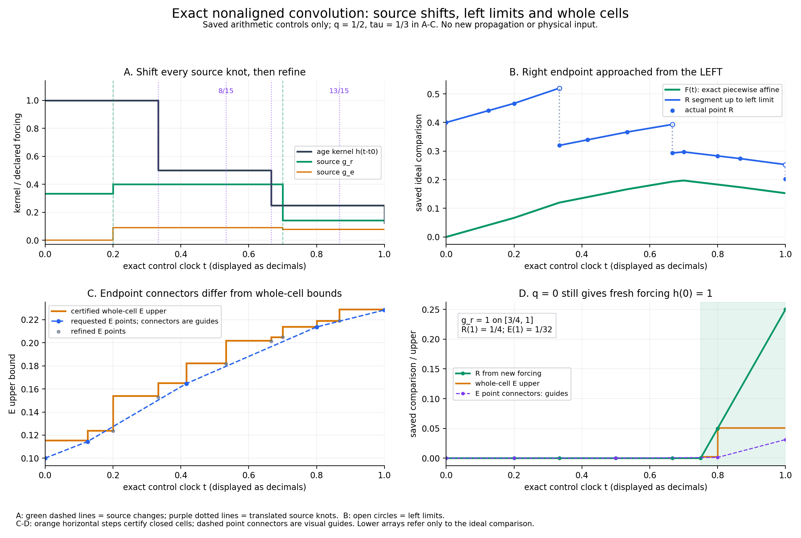
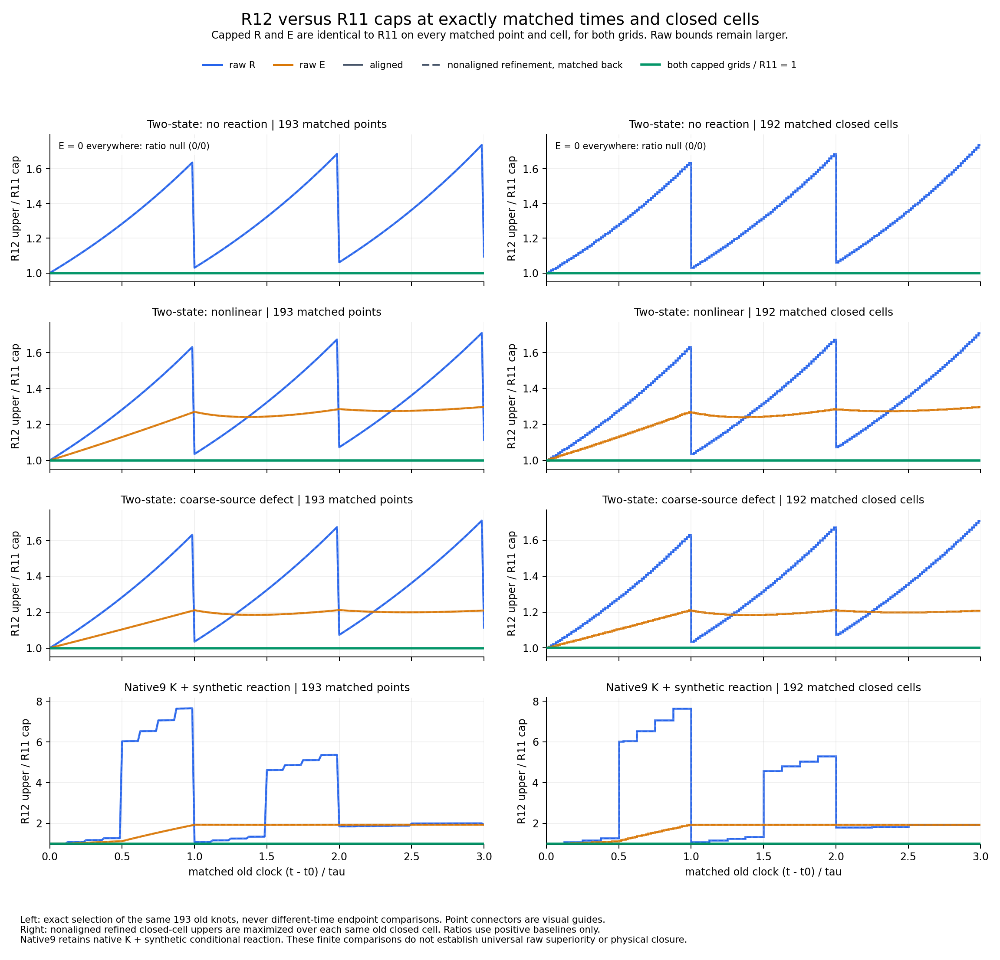

# R12 저장 출력 분석 및 그림

R12는 서로 정렬되지 않은 정확한 source/observation 격자를 처리하고, 이동한 source 경계 및 old cap 경계를 포함한 refinement를 구현·검증했다. 이번 네 saved case에서 **R11 대비 추가 capped 개선은 0%**다. Aligned 출력과 nonaligned refined 출력을 같은 기존 시각·닫힌 셀에 맞추면 모든 capped R/E가 기존 값과 정확히 같다. 이는 이번 실제 입력의 결과이며 새 방법의 일반적 성능을 단정하지 않는다.

## 실제 실행 근거

Primary **531/531 PASS**, failure0. 독립 reference **317/317 PASS**, **133,502 component comparisons**, failure0. 각 Python 과학 실행은 1회이며 전체 OS CPU는 primary 1.103768초, reference 3.098666초, 합 **4.202434초**다. 이 합계는 import와 serialization을 포함하고 그림·저장 출력 후처리를 포함하지 않는다.

Reference는 exact Fraction J primitive와 독립 event grid, Decimal160 closed forms를 사용했다. Decimal 비교는 실행 전 고정한 `1e-80*max(1,abs(reference),abs(lower),abs(upper))` guard를 쓴 **GUARDED_CORROBORATION_NOT_INTERVAL_REFERENCE**다. 이 reference 자체를 interval arithmetic이나 무제한 정확성 증명으로 부르지 않는다. Component 구성은 metadata894, coverage44,719, exact68,870, decimal19,019다.

Wolfram은 새 제출에서 24개의 zero residual을 반환했다. `Symbol::undefined2`의 L/V 경고 및 `General::messages`를 보존하며, 원인은 `NOT_ESTABLISHED`, 판정은 **QUALIFIED_SYMBOLIC_CORROBORATION**이다. Zero residual만으로 전체 정리나 물리 closure를 채택하지 않는다.

입력 증거: `raw/PRIMARY_RESULTS.json`, `raw/REFERENCE_RESULTS.json`, 두 `*_PROCESS.json`, `raw/CAS_ASSESSMENT.json`. 원본 bytes/SHA와 정확한 전체 통계는 `analysis/SAVED_OUTPUT_SUMMARY.json`에 있다. 그림 후처리의 별도 관리 CPU와 실제 process 기록은 `analysis/POSTPROCESS_PROCESS.json`에 둔다.

## 정확한 격자와 작업 수

저장된 constant g_r/g_e의 모든 원소가 정확히 같은 것을 확인한 뒤 source cell 하나로 압축했다. 모든 사례는 3개의 full block을 사용한다. Nonaligned의 새 interior observation point191개에는 old point cap을 적용하지 않았다. Old knots193개를 refined grid 안에 유지하여 closed-cell 포함 관계를 이용했다.

| 사례 | 격자 | source / observation / refined cells | overlap terms | 서로 다른 scalar 길이 |
|---|---|---:|---:|---:|
| 2상태 무반응 | aligned | 1 / 192 / 192 | 772 | 1 |
| 2상태 무반응 | nonaligned | 1 / 192 / 383 | 1536 | 5 |
| 2상태 비선형 | aligned | 1 / 192 / 192 | 772 | 1 |
| 2상태 비선형 | nonaligned | 1 / 192 / 383 | 1536 | 5 |
| 2상태 coarse-source defect | aligned | 1 / 192 / 192 | 772 | 1 |
| 2상태 coarse-source defect | nonaligned | 1 / 192 / 383 | 1536 | 5 |
| Native9 조건부 fixture | aligned | 1 / 192 / 192 | 772 | 1 |
| Native9 조건부 fixture | nonaligned | 1 / 192 / 383 | 1536 | 5 |

## 최종 upper

표시는 15자리 근사다. JSON에는 exact rational 값을 보존했다. 두 격자의 capped 최종 R/E는 서로, 그리고 R11의 같은 최종시각 값과 정확히 같다. E=0인 baseline의 상대비는 0%로 바꾸지 않고 null이다.

| 사례 | 격자 | raw R(T) | raw E(T) | capped R(T) | capped E(T) |
|---|---|---:|---:|---:|---:|
| 2상태 무반응 | aligned | 0.06103515625 | 0 | 0.0557825400371075 | 0 |
| 2상태 무반응 | nonaligned | 0.06103515625 | 0 | 0.0557825400371075 | 0 |
| 2상태 비선형 | aligned | 0.0670615623147999 | 0.000514553889690015 | 0.0602119158660167 | 0.000396434054402575 |
| 2상태 비선형 | nonaligned | 0.0670615623147999 | 0.000514553889690015 | 0.0602119158660167 | 0.000396434054402575 |
| 2상태 coarse-source defect | aligned | 0.0670615623147999 | 0.000683240624257362 | 0.0602119158660167 | 0.000565120788969921 |
| 2상태 coarse-source defect | nonaligned | 0.0670615623147999 | 0.000683240624257362 | 0.0602119158660167 | 0.000565120788969921 |
| Native9 조건부 fixture | aligned | 0.0000701971878504450 | 0.00000119238424255714 | 0.0000364476161178182 | 6.19079240657234e-7 |
| Native9 조건부 fixture | nonaligned | 0.0000701971878504450 | 0.00000119238424255714 | 0.0000364476161178182 | 6.19079240657234e-7 |

## 같은 기존 시각·닫힌 셀에서의 비교

Aligned는 기존193점/192셀을 그대로 사용했다. Nonaligned는 refined point에서 **동일한193 old knot**를 선택하고, 각 **동일한 old closed cell**에 포함되는 refined whole upper의 최댓값을 취했다. 다른 시각의 요청 endpoint를 직접 비교하지 않았다.

각 격자에서 4사례의 capped point 성분1,544개와 whole-cell 성분1,536개가 R11 cap과 정확히 같다. 두 격자 합계는 point3,088개와 whole-cell3,072개이며 개선·악화 성분은 모두0개다. Positive baseline에서 최대 strict 개선은0%; denominator0이면 null이다.

Raw에서 R11 cap보다 큰 성분 수는 다음과 같다. 두 격자를 같은 old clock으로 맞춘 뒤의 count가 동일하지만 scalar outward rounding의 일부 exact 값까지 동일하다는 뜻은 아니다.

| 사례 | 격자 | R point 큰 값 /193 | E point 큰 값 /193 | R whole 큰 값 /192 | E whole 큰 값 /192 |
|---|---|---:|---:|---:|---:|
| 2상태 무반응 | aligned | 192 | 0 | 191 | 0 |
| 2상태 무반응 | nonaligned | 192 | 0 | 191 | 0 |
| 2상태 비선형 | aligned | 192 | 192 | 191 | 192 |
| 2상태 비선형 | nonaligned | 192 | 192 | 191 | 192 |
| 2상태 coarse-source defect | aligned | 192 | 192 | 191 | 192 |
| 2상태 coarse-source defect | nonaligned | 192 | 192 | 191 | 192 |
| Native9 조건부 fixture | aligned | 192 | 192 | 191 | 192 |
| Native9 조건부 fixture | nonaligned | 192 | 192 | 191 | 192 |

이 결과에서 raw의 보편적 우위를 주장하지 않는다. 상대 개선은 반드시 `100*(old-new)/old`를 positive old baseline에만 계산했다. Exact per-component 변화, 최대 strict 개선·최대 악화 및 denominator0의 null 기록은 JSON에 있다.

## Raw E 구간 폭과 refinement

| 사례 | 격자 | requested E 최대 폭 | refined E 최대 폭 | 최종 E 폭 |
|---|---|---:|---:|---:|
| 2상태 무반응 | aligned | 0 | 0 | 0 |
| 2상태 무반응 | nonaligned | 0 | 0 | 0 |
| 2상태 비선형 | aligned | 5.93624647165255e-37 | 5.93624647165255e-37 | 5.93624647165255e-37 |
| 2상태 비선형 | nonaligned | 1.17255561494523e-36 | 1.17255561494523e-36 | 1.17255561494523e-36 |
| 2상태 coarse-source defect | aligned | 5.84808439534088e-37 | 5.84808439534088e-37 | 5.84808439534088e-37 |
| 2상태 coarse-source defect | nonaligned | 1.16080067143701e-36 | 1.16080067143701e-36 | 1.16080067143701e-36 |
| Native9 조건부 fixture | aligned | 5.64237288394698e-37 | 5.64237288394698e-37 | 5.64237288394698e-37 |
| Native9 조건부 fixture | nonaligned | 1.12553584091234e-36 | 1.12553584091234e-36 | 1.12553584091234e-36 |

같은 old knot에서 kernel/F/R exact 값이 두 격자 사이에 일치했고, 같은 ideal E를 감싸는 두 outward 구간은 겹쳤다. 세분화는 outward rounding 누적 폭을 바꿀 수 있으므로 E 출력의 bitwise 동일성이나 monotone width 개선을 가정하지 않았다. 독립 reference의 guarded Decimal 비교가 이를 별도로 확인했다.

## 두 그림의 읽기

### 그림 1 — 비정렬 source 경계와 fresh forcing

`NONALIGNED_CONTROL_GEOMETRY`는 translated-source control의 source knots, source에서 이동한 경계8/15·13/15, step kernel, exact F 및 R affine segment를 표시한다. R의 open circle은 **셀의 오른쪽 끝점에 왼쪽에서 접근한 극한**이고 filled point는 해당 끝점의 실제 비교값이다. E의 dashed endpoint 연결선은 시각적 안내이며 orange whole-cell steps가 각 닫힌 셀의 upper를 나타낸다. 별도 q=0 control은 마지막 [3/4,1]에 들어오는 새 forcing이 h0=1을 가지므로 최종 R=1/4, E=1/32임을 보여 준다.

### 그림 2 — 동일한 R11 clock과 cap으로 비교

`MATCHED_R11_CAP_COMPARISON`의 왼쪽 열은 같은193점, 오른쪽 열은 같은192 old closed cell이다. 오른쪽 nonaligned 값은 해당 old cell 안의 refined upper 최댓값으로 집계했다. 파란색은 raw R, 주황색은 raw E이며 실선/파선은 aligned/nonaligned를 구별한다. 초록색 ratio1은 두 격자의 capped 출력이 R11과 정확히 같음을 뜻한다. Positive baseline만 ratio를 표시하며, no-reaction E는 모두0이므로 0/0 ratio를 생략하고 null로 기록했다. Point plot의 연결선은 whole-cell 인증으로 읽지 않는다.

PNG와 SVG를 함께 제공한다. 모든 PNG chunk CRC·정확한 IEND 끝·Pillow full decode 및 SVG XML을 확인한 뒤 atomic replace로 저장한다. 최종 bytes/SHA는 `figures/FIGURE_MANIFEST.json`에 있다.

## 범위와 보존 사항

Native9은 **native K + synthetic conditional reaction fixture**다. Actual HD reactive array와 named physical consumer/density/clock은 INPUT_PENDING이다. HH_R10=OFF, production=NOT_ISSUED, L4=false, central/physical delta=0, native v=UNSPECIFIED, MISSING_NOT_ZERO 및 TIQM/SQM 구별을 보존한다.

Raw lower는 고정한 rational-q ideal comparison의 lower이며 실제 물리 오차의 lower가 아니다. 새 물리 closure 또는 모든 입력에 대한 raw 우위를 주장하지 않는다. 이번 후처리는 저장 값을 선택·집계·비교·그렸고 새 solver, ODE, generator, CAS, predecessor module import 또는 saved sample campaign을 실행하지 않았다. R8 original726/727+1FAIL과 별도24/24, R10/R11의 원래 sample tolerance 및 경고·실패 기록은 변경하지 않았다. R12의 새 sample containment 결과를 만들지 않았다.
