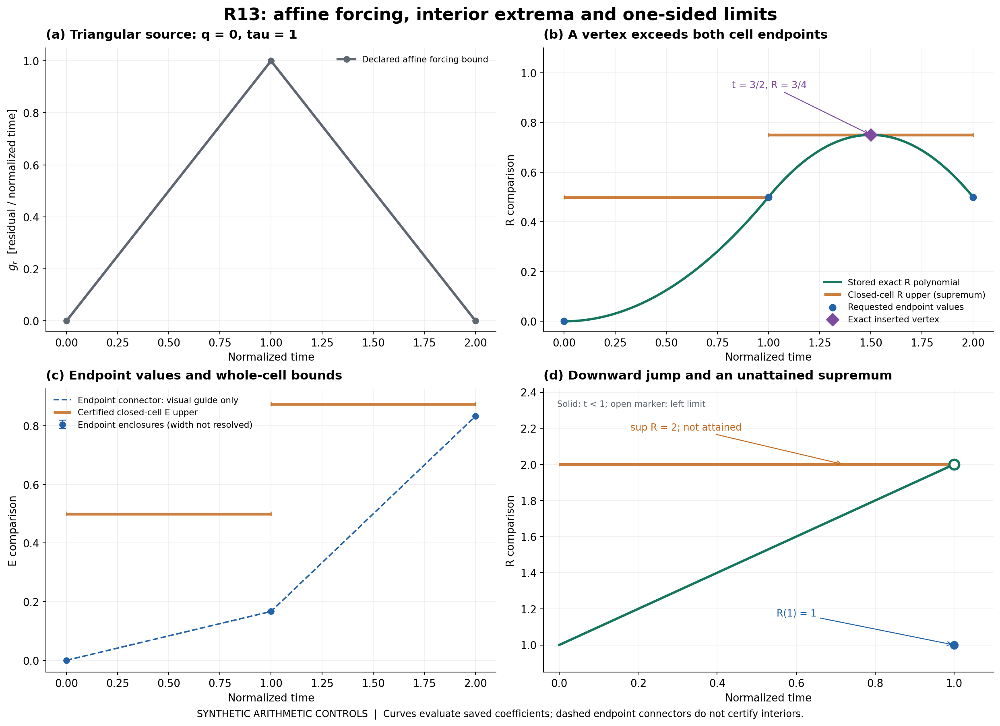
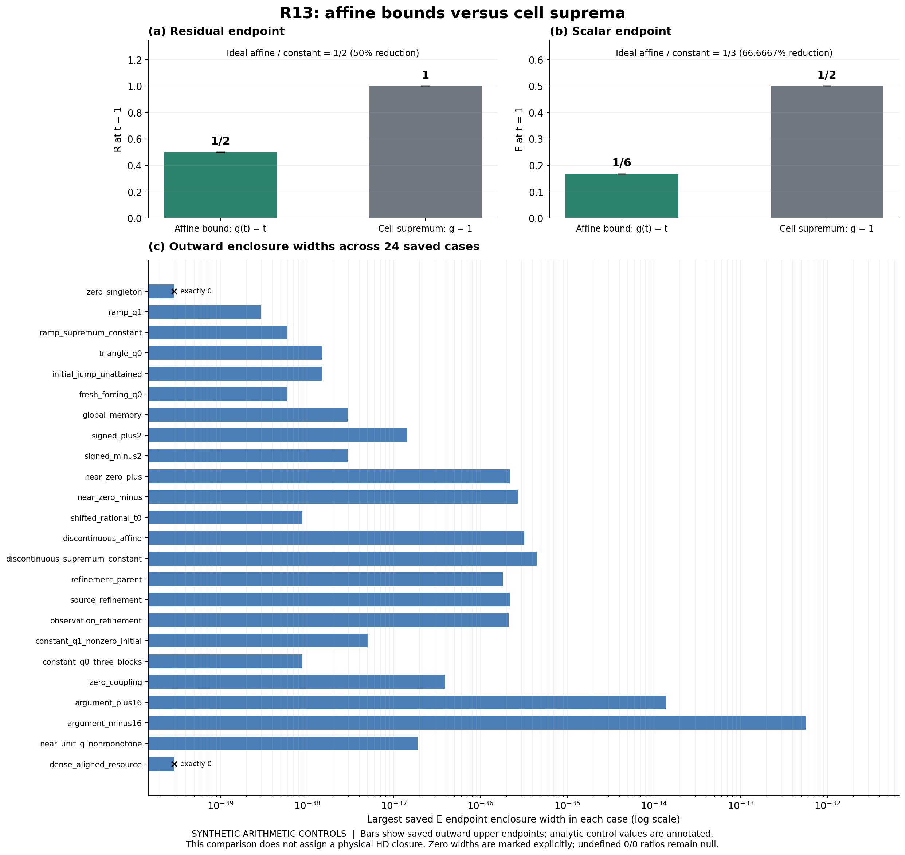

# R13 완료 보고 — affine forcing의 정확한 기억 적분과 유한 검증

## 완료 결과

최신 자료를 대조해 R12의 비정렬 상수 forcing 연구가 이미 완료되어 있음을 확인했다. 해당 과학을 반복하지 않고, 그 위에 **비음수 piecewise-affine whole-domain forcing**을 허용하는 새 R13 이론·코드 루프를 실행했다. **이론 R1–R10 + 코딩 C1–C10 =20/20**, 과학 DAG는 **25/40 → 신규2개등록25/42 → 조건부채택27/42**다. 기존40개 node 객체 변경은0이다.

새로 채택한 node는 WU_HD_AFFINE_FORCING_THEORY_R13과 WU_HD_AFFINE_FORCING_CODE_R13이며, 두 node 모두 COMPLETE_SCOPED_CONDITIONAL이다. 실제 물리 입력 결속과 생산 발급은 이 진도에 포함하지 않는다. [채택](SCIENTIFIC_ADMISSION.json), [DAG](DAG.json), [workflow](WORKFLOW_RECORD.json), [직접 증명](theory/PROOF_KO.md), [상세 결과](RESULTS_KO.md)

| 실제 검증 | 결과 |
|---|---:|
| Primary | 311/311 PASS_SCOPED; 유효24사례, 거절guard38/38 |
| 독립 reference | 125/125 PASS; 8,408성분 비교, 실패0 |
| Reference 구성 | metadata1,590 / exact4,525 / Decimal350 / coverage1,943 |
| 과학 Python 실행 | primary1회 + reference1회 |
| 두 전체 OS process CPU | 1.334749초; import·serialization 포함 |
| 실행 동결 파일 | 14/14 bytes·SHA 일치 |
| 과학 payload | 57파일; S09 원격 Git blob ID·size57/57 일치 |
| 독립 C9 | PASS_SCOPED_FINAL_C9; 열린 중대·경미0/0 |
| Wolfram | 1회, residual25개 모두0; 메시지 있는 qualified corroboration |
| R13 primary/reference/CAS remaining | 0/0/0 |

실행 원장은 [EXECUTION_LEDGER.json](EXECUTION_LEDGER.json), 실제 출력은 [primary](raw/PRIMARY_RESULTS.json)와 [reference](raw/REFERENCE_RESULTS.json), review는 [C9](reviews/C9_FINAL_REVIEW.json)다. Reference raw CPU 문자열0.5414380000000000003과 합계1.3347490000000000003은 원본에 보존했다. 표시값만 여섯 자리로 정리했다. 후처리·조사·게시·remoteCAS CPU를 이 과학 subtotal에 넣지 않았고 full historical CPU는null이다.

## 1. 조사 범위와 연구 선택

GitHub cutoff는 **2026-10-28 15:58:58.660KST**다. 접근 가능한51repos의2,398heads를66branchpages의 terminal까지 열거했다. 공개35repos/1,915heads와 비공개16repos/483heads를 구별했고 공개 산출물에는 비공개 식별자를 넣지 않았다. R12 공개 기준 대비 신규13, 이동7, 삭제0, 불변1,895다. 관련19변경ref를 선별하고17branch의18원문을 읽어18/18 Gitblob identity를 확인했다. 모든 branch metadata를 열거한 것과 모든 파일 본문을 읽었다는 주장을 구별한다. 일부 commit diff의100path cap 및11/19 AGENTS404도 조사 기록에 남겼다. [GitHub census](authority/intake/github/PUBLIC_CENSUS.json), [종합](authority/intake/SYNTHESIS_KO.md)

Drive는14WUroot에서167folder목록,1,235고유항목 중1,082files를 조회했다. Dropbox WU관련 범위는1,121고유항목 중995files이며 상위dossiers3,509항목/6pages,현재WU644항목/2pages까지 terminal이다. R11/R12/reconciliation의23ZIP쌍은 양쪽 크기23/23일치다. 이것은 기존 객체 metadata 확인이며 새 upload ACK나 원본 ZIP 다운로드 검증이 아니다. R12 FINAL8,004,713bytes의 양쪽 metadata와 PR의 기존SHA/receipt도 확인했다. [Backup census](authority/intake/backups/CENSUS_REPORT_KO.md)

별도 대화의 PersonalContext 호출은 실제로 UNAVAILABLE를 반환했다. 접근할 수 없는 대화 내용을 읽었다고 세지 않았다. 첨부 archive는 central directory 및 지정 일부 문서의 제한된 범위를 읽었으며 그 경계를 [ATTACHMENT_SCOPE](authority/intake/backups/ATTACHMENT_SCOPE.json)에 남겼다. Backup 읽기는16:06:54KST 종료했다. 전체 조사는 원자적snapshot이 아니며 이 범위로 전역 자료 부재를 주장하지 않는다.

구체적인 새 근거와 WU에 사용한 판단은 다음과 같다.

| 의존성 | 실제 새 관찰 | 이번 WU에 미친 영향 |
|---|---|---|
| REI central7937ed4a842e… | central28/88; 기존9WU객체가 이전 정합성source와JSONexactequal | 중앙·물리delta0 유지 |
| REC thermal-path | 313queries/89cells,18/20,physical0/313 | Source 진도와 physical 발급을 구별 |
| BASS native | residual/jump/initial-error 분리,18/20reviewheld | 초기값·forcing memory·jump 의미를 분리 |
| Vigil chemical source | quadratic remainder와 entry extrema; 실제 rate/full30/REI25결속pending | Whole-domain forcing 전제를 실제 수치sample과 구별 |
| HEQUARTIC12 | full polynomial positivity와 충분조건인 Bernstein계수cone의 차이 | WU에서는 vertex분할 후 B2계수 양성을 별도로 직접증명 |
| CR | 조건부 consumer·pair support 근거 | WU physical binding으로 올리지 않음 |

종료 전 지정7ref만 **17:34:26.695–17:34:27.284KST** 다시 확인했다. Census 대비1이동/6불변이다. 이동한 REI causal-prefix는ebf59d21fb7d97a3c6cf01c1af12a7afbc671f7d이며7commit/7경로다. 온도 변환식의 represented multiplication residual rho_theta를 남기는 F1 교정과 native R6/C9 심사를 추가했다. 해당 thermal unit은13/20→15/20(theory6/10,code9/10),working33/88,central28/88,canonicaldelta0이다. Source의 targeted saved-data check1회는 REI 기록이며 WU 실행으로 세지 않았다. 9개 source snapshot의 Gitblob은9/9일치했다. 실제 HD array나 named WU physical binding은 이 이동분에서 제공되지 않았다. [종료 변경분](authority/closeout_delta/dependency/REPORT_KO.md)

## 2. 직접 증명·구현한 내용

H=pi*d^T-diag(d), A=K+wH를 유지한다. K/pi/destruction고정, 전체wbox, 모든시작시각, zero-mass residual 및 whole-fine/coarse forcing 전제다. R11의 full-A q/tau certificate를 그대로 전제로 쓰고 nominalK rho를 A에 이식하지 않는다. h(age)=q^floor(age/tau), h0=1(q=0포함), E=abs(eta), coarse l1=4E, 고정c>=0와signedd_c를 유지한다.

Affine forcing의 sourcecell과 age strip 교집합[L,U]에서 적분은 정확히 (U-L)[g(L)+g(U)]/2이다. 원래t0부터 모든sourcecell의 q^k가중항을 합해 globalRmemory를 유지한다. Source·observation·translatedknots·initialblockjumps의 exact rational union을 만들면 각basecell의 R은quadratic이다. 양끝과midpoint는 이 이미증명된 다항식의 exact 복원에 쓰이며 sample interpolation으로 wholebound를 가정하지 않는다.

각quadratic의 strict interior rational vertex를 추가하면 각subcell에서 R이단조다. B0=P(0), B1=P(0)+Delta P'(0)/2=P(Delta)-Delta P'(Delta)/2, B2=P(Delta)의비음수를직접보였다. Affine ge를degree2로올리고Q_i=cB_i+ge_i를만든다. 양의W_i=Delta integral_0^1 exp(z(1-u)) B_i^2(u)du로signed scalar를전파하며,z<0에서는 exp(z)와indexreversal을사용한다. 구현은dyadic128/Taylor96 및명시적tail을사용하고독립reference는exactJ0/J1과Decimal160 monomialphi를사용한다. Guard1e-80는실행전고정이며 numericalcorroboration이다.

WholeR은 actualendpoint와right-endpointleftlimit를구별한supremum이다. WholeE는상수majorant의endpoint최대값으로증명한다. 실제E의cell내단조성을가정하지않는다. 이구성은exactideal source/observationrefinement invariance를보존하며반올림결과bitidentity를주장하지않는다. [정리/API](theory/THEOREM_AND_API_KO.md), [식·코드대응](theory/EQUATION_CODE_MAP_KO.md)

Finite code는states1..13,source/observationcells각1..64,base<=2048,vertexrefined<=4096,fullblocks<=8,inputbits256,derivedbits16384,abs(d_c)*(T-t0)<=16이다. (3*Nbase+1)*Nsource*(B+1)<=200000을첫overlap계산전에검사한다. 모든개별최대값조합을자동허용하지않는다. Singleton에서는zero-mass와일치하게R0=0및grendpoint0을강제한다. Sourcebyteshash와canonicalsource/state/clock/knots/forcinghash를검증하며staleforcinghash를거절한다. [유한자원계약](theory/FINITE_RESOURCE_AND_CONTROLS_KO.md)

## 3. 결과의 판별력과 한계

삼각형 forcing의 양끝 R(1)=R(2)=1/2 사이에서 R(3/2)=3/4를 정확히찾았다. IdealE(2)=5/6이고 실제wholeEupper는7/8+2^-127이다. 별도initial-jump사례에서는 실제R(1)=1,왼쪽극한2,달성되지않는supremum2를구별했다. Globalmemorycontrol은R(5/4)=9/8,E(5/4)=49/64다.

Ramp gr(s)=s와같은셀의supremumconstant gr=1을동일조건에서비교하면 t=1에서R은1/2대1,E는1/6대1/2다. 따라서ideal비교값감소는각각50%,200/3%이다. 이는합성arithmeticcontrol이며NativeHD물리개선률,R11/R12capped endpoint개선률,보편적인strict개선주장이아니다. R11/R12의기존capped동일/추가개선0%결론은그대로유지한다. 저장된outwardratio와exactidealratio도분리했다. 0/0비율은null이다.

Rawlower는chosen-rational-q idealcomparison의lower이며physicalerror의lower가아니다. R13은새genericcapadapter를제공하지않고변경된affineforcing에R11cap을자동결속하지않는다. Endpoint연결선은visualguide이고whole-cell인증은별도선이다. 모든24case는syntheticarithmeticcontrols이며actualHDarray/namedphysicalconsumer/state/density/clock은조사범위에서INPUT_PENDING이다. HH_R10OFF,productionNOT_ISSUED,L4false,central/physicaldelta0,NativevUNSPECIFIED,MISSING_NOT_ZERO,TIQM/SQMdistinct를유지한다.

## 4. 도구·심사·실패 이력

SciSpace검색1,Exa검색1/fetch1(3URLs)을실제문헌대조에사용했다. Hochbruck–Ostermann의phi정의와Al-Mohy–Higham의다항inhomogeneity표현을재사용했고,독립reference의식구성과production의양의moment선택을구분했다. 전체문헌의신규성이나strongno-go를주장하지않는다. [문헌/readscope](authority/literature/LITERATURE.json)

Wolfram의새evaluator1회는25zeroresidual을반환했지만Power::infy3회와General::messages도반환했다. CauseNOT_ESTABLISHED,QUALIFIED_SYMBOLIC_CORROBORATION이다. 실제제출1900bytes의SHA는d5a342330d34a015e9617c3054f1c14d3ffa82af294df5a4005bc747f0d8ed4e이며동결script와정확히같다. 경고를지우기위해다시실행하지않았다. [원문](raw/CAS_TOOL_RESPONSE.json)

R13-F01은maximum→supremum교정이며옛초안bytes를보존했다. F02는primary CLI/root/exclusive-output교정이며옛hash는관찰했으나옛bytes는NOT_PRESERVED다. F03은후처리의PASS/PASS_SCOPED상태명불일치로첫그림생성전에실패했다. 옛스크립트bytes와진단을보존하고후처리만교정해두PNG/두SVG를생성했다. PNG모든CRC/full decode/IEND와SVGXML/실제시각검증을통과했다. 두번째후처리OSCPU4.7715749999999995초는과학subtotal에서제외했고첫실패후처리CPU는미측정null이다. Matplotlib의임시cache경고도원문에남겼다.

R8 original726/727PASS+1FAIL과별도exactphi24/24, R10 primary175/reference469/components9860/CPU0.511886/frozen14 및최초ID실패/DOC01/META02, R11 primary214/reference900/components19195/CPU1.477435/frozen18 및F01/F02/첫PNG실패bytes·원인미확정/S08temporary/S09삭제, R12 primary531/reference317/components133502/CPU4.202434/frozen30 및교정이력을모두이전immutableleaf에보존했다. R10원readout4.0013206434938575e-12와fixedtolerance4.377656370786352e-11,R11strictsamplefalse/upper초과349및qualifiedCAS를바꾸지않았다. R10당시provideroriginalGETNOT_RUN과R11입력복구DriveGET도구별한다.

## 5. 단계별 실제 게시·백업

R_n/C_n을같은checkpoint로묶어10단계에서20개루프단계를기록했다. 각행에당시과학DAG완료수를남겼다. 실제receipt의archive명·bytes·SHA·양쪽ID는[PUBLICATION_INDEX](delivery/PUBLICATION_INDEX.json)에있다.

S01–S10 **10/10** checkpoint가 실제 게시·이중백업을 마쳤고 actual provider ACK는 **20개**다. 이 FINAL source의 자기 commit/tree/ZIP와 마지막 두 provider ACK는 PR150 및 종료 응답에 외부 기록한다. 그 ACK까지 완료되면 실제 archive는11개, ACK는22개다. 자기 receipt를 자기 source에 삽입하지 않는다.

| 단계 | 실제 작업 | Workflow | 과학 DAG | Source | 백업 |
|---|---|---:|---:|---|---|
| S01 / R1·C1 | 범위·권한·새유한단위 | 2/20 | 25/42 | [`ab18d0a13a83`](https://github.com/cosmosapjw-quantum/WU088_HH/commit/ab18d0a13a837ce0aadc3956cecdc42e1570b1ac) | [Drive](https://drive.google.com/file/d/1x3f3YhHMeApKmN77TegViH6bSW0umOjy/view?usp=drivesdk) · Dropbox ACK |
| S02 / R2·C2 | 최신자료·문헌·식코드대응 | 4/20 | 25/42 | [`a17c9655ad2a`](https://github.com/cosmosapjw-quantum/WU088_HH/commit/a17c9655ad2a7089327444647b650897c55cff07) | [Drive](https://drive.google.com/file/d/1wEOtmlDcDUvlWqEcqhF1I5LXPc1zSB16/view?usp=drivesdk) · Dropbox ACK |
| S03 / R3·C3 | 정리·API·직접증명 | 6/20 | 25/42 | [`0bfd0092a243`](https://github.com/cosmosapjw-quantum/WU088_HH/commit/0bfd0092a243dbce356571dc8296b596a3e24d98) | [Drive](https://drive.google.com/file/d/1vA-JMU_tTxEtiKM6cjPVIE-t4CwWhVJ_/view?usp=drivesdk) · Dropbox ACK |
| S04 / R4·C4 | 유한자원·controls·CAS계약 | 8/20 | 25/42 | [`473753532ff1`](https://github.com/cosmosapjw-quantum/WU088_HH/commit/473753532ff148688416d9e468ff7df11164b770) | [Drive](https://drive.google.com/file/d/14ucAMUNu9PpfN_G0QoRY_Vf2h1Jmtv_-/view?usp=drivesdk) · Dropbox ACK |
| S05 / R5·C5 | 구현·독립reference·실행전동결 | 10/20 | 25/42 | [`8d71b38b4470`](https://github.com/cosmosapjw-quantum/WU088_HH/commit/8d71b38b4470333dbb6a5f2ac85e381a45b4710c) | [Drive](https://drive.google.com/file/d/1a6dZ8fkv1F8MlgItIgw6_MVgV4obKgPd/view?usp=drivesdk) · Dropbox ACK |
| S06 / R6·C6 | primary·CAS·독립R6 | 12/20 | 25/42 | [`bac56f7d5bc1`](https://github.com/cosmosapjw-quantum/WU088_HH/commit/bac56f7d5bc16dd8a6a9dbb1e0b7035400c20db8) | [Drive](https://drive.google.com/file/d/1f62ySsikmNkush2jDol1q8FJL8kzHohW/view?usp=drivesdk) · Dropbox ACK |
| S07 / R7·C7 | 독립reference·실행원장 | 14/20 | 25/42 | [`2d369aed562a`](https://github.com/cosmosapjw-quantum/WU088_HH/commit/2d369aed562a0776510475bcfebbb6a707178287) | [Drive](https://drive.google.com/file/d/146jY2scG3tUW568wk_69nt_rIm7yPOfP/view?usp=drivesdk) · Dropbox ACK |
| S08 / R8·C8 | 결과해석·저장그림 | 16/20 | 25/42 | [`58427cc1d7b2`](https://github.com/cosmosapjw-quantum/WU088_HH/commit/58427cc1d7b261ddf0c231d631e4ea65fde13d8f) | [Drive](https://drive.google.com/file/d/1-jc7Hh9bRCbev2P6pLdwfBs0ZNNrm6X6/view?usp=drivesdk) · Dropbox ACK |
| S09 / R9·C9 | 독립C9·조건부과학채택 | 18/20 | 27/42 | [`37db6e1fdb91`](https://github.com/cosmosapjw-quantum/WU088_HH/commit/37db6e1fdb915b85d7547b77e3c01fa15218b193) | [Drive](https://drive.google.com/file/d/1trjIumjAUYmUlhyJM94kLFT5PfeZroUc/view?usp=drivesdk) · Dropbox ACK |
| S10 / R10·C10 | 보고·handoff·종료정합성 | 20/20 | 27/42 | [`5e273a4fe838`](https://github.com/cosmosapjw-quantum/WU088_HH/commit/5e273a4fe8388ab84882175f662f8be7de640dea) | [Drive](https://drive.google.com/file/d/1t0sYTO-cMFvr9XrcsstLQp2VlZPwgFKO/view?usp=drivesdk) · Dropbox ACK |

모든게시ref는root의expected-parent SHA와force=false로갱신했다. DraftPR150을유지하고mainmerge·다른ownerrepo쓰기는하지않았다. ZIP범위는현재AGENTS와새R13leaf의self-contained코드·입력·증거다. 전체역사repo복구용archive는아니며이전science는immutablecommit으로연결한다. LocalZIPCRC/all-memberSHA와양쪽actualACK/size를검증했고provideroriginalGET은NOT_RUN이다.

## 6. 재개에 필요한 식별자와 다음 입력

Scientific S09 commit: 37db6e1fdb915b85d7547b77e3c01fa15218b193

Scientific S09 tree: acc710c3fd56b1d4897121553174ddf15f0d4fd1

57-file scientific payload SHA256: aed8a6d7e58889de248ee88f75c2a46a7418462f4e3908393d72b64e908c6563

원격검증은[SCIENCE_REMOTE_GIT_IDENTITY](authority/closeout_delta/SCIENCE_REMOTE_GIT_IDENTITY.json)의실제S09Git treeblobID/size와local계산값57/57일치다. 모든remote본문을새로download했다는뜻이아니다. FINAL자체식별자와ACK는자기source외부PR150·종료응답에서확인한다.

[HANDOFF_KO.md](HANDOFF_KO.md)는다음대화용복사블록이다. [NEXT_INPUT_CONTRACT](followup/NEXT_INPUT_CONTRACT.json)은실제HDarray또는namedphysicalconsumer가오면source/state/units/density/clock과full-A/wholeforcing전제를먼저결속하도록정한다. 입력이없을때piecewise-quadraticforcing은proposal-only다. Cubicextrema의algebraicroot/isolatinginterval,positiveBernstein3및유한resource계약은새열린의무이며등록·구현·실행·채택하지않았다. 미래새allowance0이고이번R13권한에서R14예산을추론하지않는다.

R13및이전primary/reference/CAS잔여는0이다. 완료한과학·ODE·독립심사·전수조사를통상재개절차로반복하지않는다. 새로움직인구체적의존성이나실제입력만그때의immutableidentity로확인한다.
