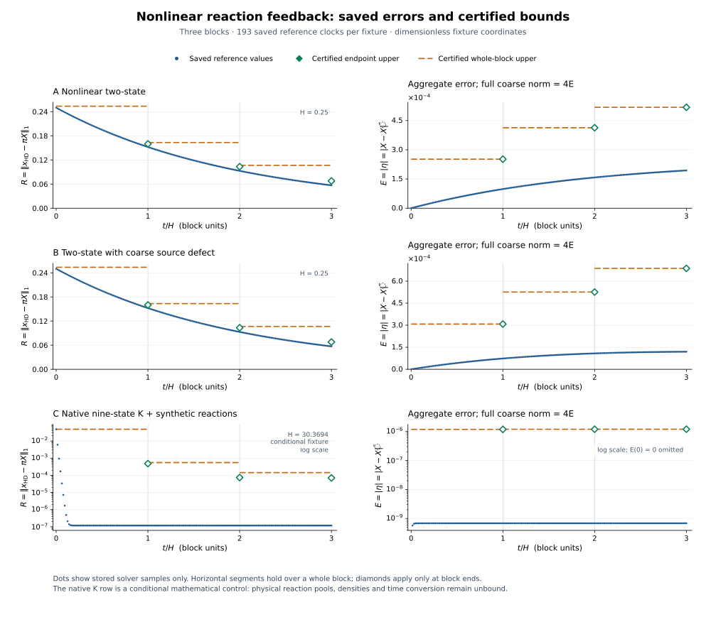

# R7 저장 결과: 비선형 반응 피드백 오차와 인증 상계

## 핵심 결과

고정 primary **144/144 PASS**, 독립 reference **376/376 PASS**를 저장 결과에서 확인했다. 두 결과 모두 실패 수는 0이다. 이 C8 작업은 저장 JSON의 표시·집계와 그림 작성만 수행했으며 과학 실행, core/reference import, ODE·행렬지수 계산 또는 새 궤적 보간을 수행하지 않았다. [P][R]

주어진 네 HD 대조군은 동일한 H/D/전하 보존량류에서 출발한다. `R`은 HD 상태분포 residual의 l1 norm이고, `E=|eta|=|X-Xbar|`이다. **전체 coarse 4성분 오차의 l1 norm은 `4E`**이다. 따라서 아래 E 상계를 전체 coarse norm 상계로 해석할 때는 4를 곱한다. 정확한 유리수 인증값은 `SAVED_RESULT_SUMMARY.json`에 그대로 보존했고 표에는 표시용 근삿값을 썼다. [P][R]

## 3블록 뒤의 최종 오차

| 대조군 | 최종 fixture 시각 | R 참조값 | R 끝점 상계 | E 참조값 | E 끝점 상계 | 4E 참조값 | 4E 끝점 상계 |
|---|---:|---:|---:|---:|---:|---:|---:|
| 2상태 무반응 대조 | 0.75 | 0.05578254 | 0.061035156 | 0 | 0 | 0 | 0 |
| 2상태 비선형 반응 | 0.75 | 0.056972025 | 0.067808656 | 0.00019400096 | 0.00051815466 | 0.00077600383 | 0.0020726186 |
| 2상태 coarse source defect | 0.75 | 0.056972025 | 0.067809398 | 0.00011962192 | 0.00068684227 | 0.00047848769 | 0.0027473691 |
| 9상태 저장 K + 조건부 합성 반응 | 91.108158 | 1.1721235e-07 | 7.0205598e-05 | 6.8257111e-10 | 1.1941991e-06 | 2.7302844e-09 | 4.7767964e-06 |

표의 참조값은 독립 DOP853 계산이 저장한 binary64 값이다. 참조 ODE가 별도의 interval enclosure라는 의미는 아니다. reference의 PASS는 저장된 부동소수점 허용오차를 포함한다. 무반응 대조에서 수학적 E 상계는 정확히 0이고 최종 참조 E도 0이지만, 중간 저장 E의 최대값은 1.110223e-16이다. 이 크기의 반올림 차이를 물리적 오차로 해석하지 않는다. [R]

9상태 조건부 대조의 최종 상계/참조값 비율은 R에서 약 599, E에서 약 1.75e+03이다. 인증이 유효하다는 결과와 상계가 날카롭다는 평가는 구별해야 한다. 이 대조에서는 공통 전역 상자와 안전한 반응 계수를 사용하는 상계가 실제 저장 오차보다 상당히 크다. 이 비율은 저장된 두 수의 표시용 나눗셈이며 추가 solver 결과가 아니다. [P][R]

coarse source defect 대조의 양의 `kf` offset은 `1/10000`, 인증된 scalar defect 상계는 `9/40000`이다. 이 항을 포함하면 E 인증 상계는 증가한다. 이번 저장 궤적에서는 실제 E가 offset 없는 대조보다 작다. 절댓값을 취하기 전 오차 항의 상쇄가 가능하므로 이 한 대조의 실제 E를 offset에 대한 단조성이나 물리적 개선으로 해석하지 않는다. [P][R]

## 끝점 상계와 블록 전체 상계

끝점 재귀는 `T=W_upper-(1-rho)e1 e1^T`, `w_next=T w0+q`이다. `rho`는 초기 residual에만 적용된다. 표의 `끝점`은 해당 블록이 끝나는 시각에 유효하며 블록 내부 전체를 덮는 값이 아니다. `전체`는 감쇠 계수 d를 `max(d,0)`으로 올린 Bplus 비교계로 얻어 그 블록의 모든 시각을 덮는다. 초기 오차를 포함하므로 블록 전체 R 상계가 끝점 R 상계보다 큰 것이 정상이다. [P]

| 대조군 | 블록 | R 끝점 상계 | R 블록 전체 상계 | E 끝점 상계 | E 블록 전체 상계 |
|---|---:|---:|---:|---:|---:|
| 2상태 무반응 대조 | 1 | 0.15625 | 0.25 | 0 | 0 |
| 2상태 무반응 대조 | 2 | 0.09765625 | 0.15625 | 0 | 0 |
| 2상태 무반응 대조 | 3 | 0.061035156 | 0.09765625 | 0 | 0 |
| 2상태 비선형 반응 | 1 | 0.1599122 | 0.2536622 | 0.00025179871 | 0.00025183011 |
| 2상태 비선형 반응 | 2 | 0.1033374 | 0.16330447 | 0.00041332307 | 0.00041340614 |
| 2상태 비선형 반응 | 3 | 0.067808656 | 0.10656018 | 0.00051815466 | 0.00051827103 |
| 2상태 coarse source defect | 1 | 0.1599123 | 0.2536623 | 0.00030804171 | 0.00030808014 |
| 2상태 coarse source defect | 2 | 0.10333777 | 0.16330488 | 0.00052579523 | 0.00052589939 |
| 2상태 coarse source defect | 3 | 0.067809398 | 0.10656106 | 0.00068684227 | 0.00068699379 |
| 9상태 저장 K + 조건부 합성 반응 | 1 | 0.00047961306 | 0.048567846 | 1.1790699e-06 | 1.1790708e-06 |
| 9상태 저장 K + 조건부 합성 반응 | 2 | 7.36383e-05 | 0.00054924845 | 1.1915665e-06 | 1.1915683e-06 |
| 9상태 저장 K + 조건부 합성 반응 | 3 | 7.0205598e-05 | 0.0001432293 | 1.1941991e-06 | 1.1942009e-06 |

각 HD 대조군은 3블록과 중복 끝점을 합친 193개 저장 reference 시각을 가진다. reference는 블록마다 끝점을 포함한 65개 시각을 사용했고, production은 `0,H/4,H/2,3H/4,H`의 5개 내부 질의값을 저장했다. 그림의 파란 점은 이 저장 reference 표본만 표시한다. 주황색 수평 구간은 블록 전체 인증 상계이고 초록색 마름모는 끝점 인증 상계이다. 참조 점을 잇거나 새 solver 값으로 채우지 않았다. native 행의 로그 축에서는 정확히 0인 초기 E를 표시할 수 없어 그 점만 생략하고 축에 명시했다. [P][R]

## 보존량과 scalar 오차의 수치 잔차

모든 대조의 정확한 초기 보존량은 `H=7/2`, `D=3/2`, `charge=2`이다. 아래 값은 저장 reference check의 evidence를 옮긴 것으로, 새 적분이나 재검사를 수행한 결과가 아니다. [R]

| 대조군 | fine 보존량 최대 drift | coarse 보존량 최대 drift | s·eta 방향 최대 잔차 | coarse l1=4E 최대 잔차 |
|---|---:|---:|---:|---:|
| 2상태 무반응 대조 | 0 | 0 | 1.110223e-16 | 3.3306691e-16 |
| 2상태 비선형 반응 | 4.4408921e-16 | 4.4408921e-16 | 3.3306691e-16 | 5.5511151e-16 |
| 2상태 coarse source defect | 4.4408921e-16 | 4.4408921e-16 | 3.3306691e-16 | 5.5511151e-16 |
| 9상태 저장 K + 조건부 합성 반응 | 1.110223e-14 | 4.4408921e-16 | 1.2323476e-14 | 3.4527936e-14 |

## 산술 scale과 Taylor 꼬리 증거

고정 대조의 오차 좌표 scale은 모두 `(1,1)`, Taylor degree는 48, dyadic 정밀도는 256 bits이다. 꼬리 계산은 실제 위쪽 반올림한 확대 행렬 C의 norm을 사용한다. 아래 값은 마지막 블록에 저장된 certificate를 요약한다. 동일 대조의 B,g,H가 고정되어 있으므로 블록마다 같은 지수 커널을 사용하고 초기 오차만 재귀로 갱신한다. [P]

| 대조군 | 위쪽 scaled norm z | shift·H | exp factor 전 꼬리 상계 | 방식 |
|---|---:|---:|---:|---|
| 2상태 무반응 대조 | 0 | 0 | 0 | 정확한 B²=0 다항식 |
| 2상태 비선형 반응 | 0.00978125 | 0.00025 | 1.7272337e-77 | 양의 급수 + 위쪽 반올림 + 기하급수 꼬리 |
| 2상태 coarse source defect | 0.00978125 | 0.00025 | 1.7272337e-77 | 양의 급수 + 위쪽 반올림 + 기하급수 꼬리 |
| 9상태 저장 K + 조건부 합성 반응 | 0.00026712549 | 1.5184693e-06 | 1.7272337e-77 | 양의 급수 + 위쪽 반올림 + 기하급수 꼬리 |

양의 급수 대조의 저장 꼬리 상계는 정확히 `2^-255`이다. 이 값은 exp factor를 적용하기 전 확대 행렬 급수의 꼬리 항이다. 입력 격자화, 각 항의 반올림과 exp factor 포함구간이 별도로 존재하므로 이 숫자 하나가 전체 산술 오차를 나타내지 않는다. 특히 물리적 coarse-graining 오차나 E 자체와 동일한 양이 아니다. 무반응 대조는 정확한 다항식으로 꼬리 0을 갖는다. [P]

## 실제 실행 비용

| 실행 | 저장 check | OS 전체 process CPU | 감독 wall time | 개별 CPU 상한 | 종료 코드 |
|---|---:|---:|---:|---:|---:|
| primary | 144/144 PASS | 0.239641 s | 0.240291 s | 60 s | 0 |
| reference | 376/376 PASS | 4.632575 s | 2.903543 s | 60 s | 0 |

두 OS process CPU의 합은 4.872216 s이다. OS 기록은 import와 결과 직렬화를 포함한다. JSON 내부 finalize 시점 CPU는 각각 0.194160618 s, 4.519766046 s로 기록되어 있으나 전체 비용 표에는 감독 프로세스가 보존한 값을 사용했다. C8의 표시·집계는 신규 과학 실행 수에 포함되지 않으며 신규 과학 실행은 0회이다. 이 비용 표는 primary/reference 두 기록만 포함하고 CAS 비용은 별도 결과의 범위이다. [Pcost][Rcost]

## 적용 범위

9상태 행은 저장된 native excitation 생성자 구간의 한 K와 그 H/rho 인증을 재사용하고, 새로 선언한 합성 formation/destruction 및 저장소를 결합한 조건부 수학 대조이다. 원천 반응물 풀, 상태 정렬, 실제 밀도, branch, 물리적 시계 및 GL2022 소비자의 결합을 완료한 물리 계산으로 승격하지 않는다. 저장 reference도 `physical_consumer_admitted=false`를 유지한다. [P][R]

유리수 상계의 유효성은 기록된 전역 양성 상자, 명목 생성자 인증, source 선택, 동일 초기 보존량류와 명시적 forcing/결함 상계에 조건부이다. binary64 reference는 이 조건부 구현을 독립적으로 뒷받침한다. 한정된 대조의 통과로 다른 입력, 다른 ensemble 또는 실제 물리 소비자에 대한 승인을 발급하지 않는다. [P][R]

## 저장 증거

- [P]: [PRIMARY_RESULTS.json](../raw/PRIMARY_RESULTS.json)
- [R]: [REFERENCE_RESULTS.json](../raw/REFERENCE_RESULTS.json)
- [Pcost]: [PRIMARY_PROCESS.json](../raw/PRIMARY_PROCESS.json)
- [Rcost]: [REFERENCE_PROCESS.json](../raw/REFERENCE_PROCESS.json)
- 정확한 수치와 출처 hash: [SAVED_RESULT_SUMMARY.json](SAVED_RESULT_SUMMARY.json)
- 게시용 벡터 그림: [nonlinear_feedback_bounds.svg](nonlinear_feedback_bounds.svg)
- 재현 가능한 저장 자료 집계: [build_saved_summary.py](build_saved_summary.py)
