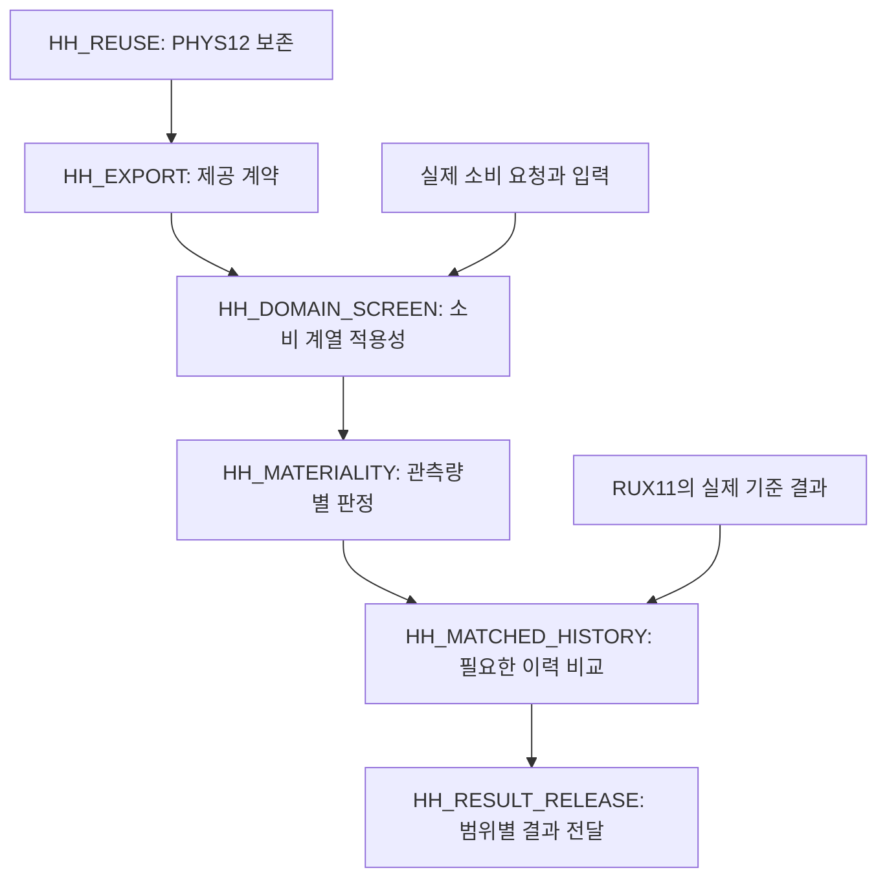

# WU088_HH — 원자물리 결과 재사용을 위한 연구계획 재편

2026-10-12 KST · HH atomic-reuse successor v2

**결정:** WU088_HH는 완료된 PHYS12를 REI가 소비할 수 있는 소스·응답 자료로 제공하고, 실제 EoR 영향은 첨부 RUX14의 선택적 경로에서 평가한다. 독립 HH 미시 충돌 연구와 strict-native 연구는 각각의 물리 목표와 전제를 유지한다. 이번 변경은 계획·제공 계약의 재편이며 새 물리 계산은 0회다.

## 1. 기준점과 첨부 자료의 의미

현재 HH 과학 기준점은 [PR46](https://github.com/cosmosapjw-quantum/WU088_HH/pull/46), commit dcea5dc6545736e6f4afa5acf4b7eabd428485e8이다. 실제 root tree는 5fdb8bfffb7e6c38f3e78fe65858541d3efb61ea, PHYS12 과학 subtree는 ff2625c424a9c2e17af99d960fd6fcdda79227f9다. 원격에서 이 head를 확인했고 기존 root 6개와 PHYS12 51개 파일의 Git blob·size가 일치했다. 이 확인은 현재 HH 기준점의 결박이며 전체 연구 프로그램의 새 물리 인증은 아니다.

첨부 REI_ATOMIC_REUSE_DAG는 17개 노드 모두 PROPOSED_NOT_EXECUTED인 successor 계획이다. 첨부의 S14는 PHYS11·PR45 계획 시점의 HH 자료를 가리킨다. 원 첨부 4개는 inputs/에 그대로 보존하고, SOURCE_REGISTRY.json의 S14_PHYS12가 이후 완료된 실제 결과를 연결한다. PHYS12를 등록했다고 global RUX00, RUX01 또는 RUX14 전체가 완료되지는 않는다.

첨부에 특정 REI branch/head의 immutable pin이 없으므로, 외부 노드의 현재 실행 완료 여부와 P01/P02A/P03A/v2 archive의 physical admission을 이 HH 계획에서 새로 판정하지 않는다. 과거 N2의 입력 누락 보고도 당시 평가된 입력에 대한 기록으로 유지한다.

## 2. 전체 프로그램에서 HH가 맡는 위치

첨부가 정한 물리 EoR 주 경로를 유지한다.

| 구간 | 담당과 실제 목적 | HH의 기여 |
|---|---|---|
| RUX00–01 | rei_bianchi의 source 권한 정리와 기존 F08/SYNC02/03 diagnostic 재사용 | PHYS12 원본·판정·표·그림을 별도 HH 자료로 제공 |
| RUX02–03 | 실제 입력 채택, H/He 과정·opacity·가열 owner 정리 | 필요한 HH 입력 조건과 선택적 HH 사건 owner 행 제공 |
| RUX04 | 하나의 source-backed 물리 scenario 고정 | 해당 scenario가 요청할 때 HH source/domain을 대조 |
| RUX05–07 | 기존 FLRW microstep과 Bianchi 수송을 사용한 첫 물리 결합 interval | 완결된 HH 정밀·native·singlet 계산을 선행조건으로 요구하지 않음 |
| RUX08–11 | FLRW/Bianchi matched EoR 이력, BASS tau/visibility, 그림과 오차 예산 | 실제 소비 요청과 HH 민감도 질문이 생기면 후속 자료 제공 |
| RUX12–15 | HE 정밀·CR·HH·공간 구조의 선택적 확장 | WU088_HH의 실제 EoR 효과는 RUX14 |
| RUX16 | 선택한 물리 모델과 관측량 범위의 최종 판정 | HH source·claim·불확실성 자료 제공; HH 자체가 global release를 대리하지 않음 |

첫 EoR baseline은 소비자가 HH OFF 또는 명시적으로 선택한 유효 closure를 모델 장부에 기록하여 진행할 수 있다. HH OFF가 허용된 모델 선택이라는 것과 HH 생략 오차가 충분히 작다고 입증되었다는 것은 별도다.

기존 H/He 기본 반응망·광이온화·가열 자료는 baseline에서 재사용한다. 선택적 고정밀 HE/CR/HH 연구가 baseline의 필수 물리 입력이나 이미 채택된 반응망까지 제거한다는 뜻은 아니다.

## 3. PHYS12에서 즉시 재사용하는 것

PHYS12의 결과는 같은 고정 계수 계열에서 미래 LCS HH를 OFF에서 ON으로 바꾼 유한 응답이다.

\[
D_{\rm HH}O(1;\alpha_s)
=O(1,1;\alpha_s)-O(0,1;\alpha_s)
=\int_0^1 U_O(\lambda,1;\alpha_s)\,d\lambda.
\]

각 full/first_half의 보존된 균일 U 포함을 사용한 결과이며, 두 단계 모두 D_HH x_HII>0와 D_HH w<0가 조건부 채택됐다. 기존 mixed I_x<0, I_w>0는 추가 광자 생성이 HH의 기여를 바꾸는 양이다. 두 종류의 양과 분모가 명시된 비율을 HH_RETAINED_RESULTS.json에 연결했다. 정확 끝점·그림·독립 과학 판정은 원 PHYS12 commit을 그대로 사용한다.

계약의 핵심은 다음과 같다.

- lambda=0은 COMMON 이후 선택한 HH 항만 끈다. 과거 HH 이력·보정·초기상태는 유지한다.
- b_amp=0에도 기존 광자가 남는다.
- full과 first_half는 COMMON에서 각각 시작한다. 서로 이어지는 시간 이력이 아니다.
- 같은 x/T 범위에 들어온다는 이유만으로 같은 source family가 되지 않는다. source equation, 고정 계수, COMMON, stage/PreBE, 변수·단위와 해 계열을 함께 확인한다.
- w는 thermal eV/H다. 온도 응답에는 입자수와 열에너지의 대응이 필요하다.
- Delta x/duration을 k(T) 또는 순간 반응률로 사용하지 않는다. 두 첫 단계 포함을 합산·시간 재조정하여 EoR 누적 오차로 쓰지 않는다.

이 조건을 유지하면 완료된 국소 결과가 제공 자료로 바로 사용된다. 다른 소비 계열에 필요하면 차이가 발생한 source·변환·history 항목만 새 작업으로 선정한다.

## 4. RUX14의 준비와 실행을 구분한 HH DAG

이 diagram의 RUX11 화살표는 실제 EoR 비교에 적용한다. HH_REUSE와 HH_EXPORT, 구체적 입력이 있는 사전 적용성 검토까지 RUX11 완료를 기다리게 만들지 않는다. 각 노드의 machine-readable 계약은 NEXT_DAG.json과 TASK_CARDS.jsonl에 있다.

| HH 노드 | 이번 상태 | 산출물 또는 다음 완료조건 |
|---|---|---|
| HH_REUSE | 기존 결과 등록 완료 | PHYS12 pin·판정·재사용 범위와 재실행 제외 목록 |
| HH_EXPORT | 계약 작성 완료, runtime 미결박 | source/owner·단위·스위치·적용 조건·소비 요청 template |
| HH_DOMAIN_SCREEN | 실제 소비 입력이 결박되면 진행 | HH_CONSUMER_ADMISSION.json: 일치, 증명된 포함, 또는 정확한 불일치 |
| HH_MATERIALITY | 조건부 미실행 | 관측량·영역·절대 허용오차와 유효한 전달 규칙에 따른 판정 |
| HH_MATCHED_HISTORY | 조건부 미실행 | 실제 RUX11 기준 결과 및 선택된 HH 질문 아래 HH_EFFECT_ON_EOR.json |
| HH_RESULT_RELEASE | 조건부 미실행 | 관측량별 효과·오차·독립 판정; global RUX16 승격은 별도 |
| HH_STRICT_NATIVE | 독립 선택 연구 유지 | 원 PHYS11 source/native/ray/guard/root/carry·next-stage 의무 |
| HH_SINGLET | 독립 미시 연구 유지 | 원자 source/basis 및 channel/spin/velocity/impact/energy/tail 의무 |

HH_STRICT_NATIVE와 HH_SINGLET은 위 EoR 준비–소비 사슬의 필수 predecessor가 아니다. 두 경로는 선택한 자체 물리 질문으로 진행할 수 있고, REI의 RUX04/RUX07/RUX11 완료를 요구하지 않는다.

## 5. 제공할 사건·반응 계약

contracts/HH_PROCESS_OWNER_ROWS.json은 세 가지 선택을 구분한다.

| 선택 | 사건 또는 의미 | 네트워크에서 구분할 점 |
|---|---|---|
| HH_DISABLED_BASELINE | 선택한 미래 HH 소스의 명시적 비활성화 | 입력 null과 source=0을 혼동하지 않음; 생략 정확도는 별도 |
| LCS_EFFECTIVE_HH_IONIZATION | H0+H0 → H+ + H0 + e_free | 순 HI −1, HII +1, 자유전자 +1; 직접 HH 광자 항 없음 |
| SINGLET_H_PLUS_H_MINUS_ION_PAIR | H0+H0 → H+ + H− | HI −2, HII +1, H− +1, 즉시 자유전자 0; H− 후속 반응 필요 |

LCS 소스의 q=nH_proper(1−x_HII)^2 k_LCS(T), H=q(1,0,0,−chi_H), k의 cm³/s 및 q의 H핵당 proper s⁻¹ 정규화를 유지한다. 기존 정의에 새로운 identical-pair 1/2를 추가하지 않는다. 열적 threshold 항은 선택한 사건 장부에서 한 번만 계산한다. 전체 결합계의 유한 D_w가 항상 −chi_H D_x와 같다고 가정하지 않는다.

Singlet 연구의 rate와 threshold 값을 이 계획에서 새로 채우지 않았다. LCS의 자유전자 소스나 threshold를 그 미시 반응에 복사하지 않는다. 실제 화학 반응망에 넣으려면 H− 변수와 후속 반응·에너지 owner까지 지정해야 한다.

REI는 실제 runtime owner로서 기존 반응율과의 중복, proper/comoving 변환, gas frame, thermal/chemical energy, Case A/B와 opacity owner를 확인한다. 여기의 HH 행은 전체 H/He owner registry를 대체하지 않는다.

## 6. 이후에 실제로 계산할 관측량

선택한 관측량 O와 geometry G에 대해 다음 두 질문을 구분한다.

\[
\Delta_{\rm HH} O_G=O(G,1)-O(G,0),
\qquad
C_\lambda=O({\rm BI},\lambda)-O({\rm FLRW},\lambda),
\]
\[
\Delta_{\rm HH} C=C_1-C_0.
\]

첫 식은 한 배경에서의 HH 기여, 마지막 식은 HH가 Bianchi–FLRW 차이에 주는 기여다. 이는 다음 연구의 computational target이며 이번에 평가한 수치는 아니다. x_HII(t), T_g(t), n_e(t)를 우선 다루고 tau/visibility는 실제 BASS receiver가 결박된 경우에만 포함한다.

논리적으로 FLRW/BI × HH OFF/ON의 네 경우를 정의한다. 이 네 경우가 항상 새 실행 네 개를 뜻하지는 않는다. 입력·소스·closure·solver·판정 범위가 일치하는 저장 이력을 먼저 재사용하고 빠진 경우만 계산한다. 한 geometry의 ON/OFF는 같은 물리 입력을 유지하며, geometry 사이에서 바꾸는 배경·shear 조건도 결과를 보기 전에 고정한다.

중요도 판정에는 관측량 단위·영역·norm과 절대 HH 예산 epsilon_HH를 명시한다.

| 유효한 소비 관측량 bound가 주는 정보 | 허용되는 결정 |
|---|---|
| 불확실성을 포함한 상계 B_O ≤ epsilon_HH | 그 관측량·영역·모델·정확도에서만 생략 지지 |
| 절대 효과의 채택된 하계가 epsilon_HH 초과 | 그 범위에서 효과가 중요함을 확정 |
| 상계만 epsilon_HH를 넘거나 구간이 기준을 가로지름 | 추가로 필요한 작은 평가를 선정; 상계만으로 중요하다고 단정하지 않음 |
| 소비 입력·threshold·source 또는 전달 규칙 미결박 | 정확한 미결 항목을 기록; 작다고 해석하거나 원자 계산 전체를 재시작하지 않음 |

독립적인 HH 응답 자체가 연구 질문이면 생략 판정 없이도 명시된 응답 계산을 선택할 수 있다. 수치 오차 예산과 물리적 HH 기여의 크기는 서로 구분한다. 현재 consumer와 epsilon_HH는 null이며 HH 생략 결론은 없다.

## 7. 경로별 NCP 정책

현재 heavy_queue=[]; launch=false; NO_HEAVY_JOB_READY다. 계획 변경으로 과학 작업이나 대형 계산을 새로 배정하지 않았다.

첨부의 RUX04/RUX07 no-new-heavy 조건은 REI EoR 소비용 계산에 적용한다. RUX14 이력 연구에는 실제 RUX11 기준 결과와 HH 적용성·선택된 관측량 질문도 필요하다. 독립 FT03와 microscopic 경로는 baseline/OBSERVABLE_FIRST_NCP_TASKS.json의 고유 입력·과학 의무를 유지한다.

모든 경로에서 실제 미완료 executable manifest, 고정 입력, 필요한 비용, 안전한 독립 분할이 있어야 NCP를 선택한다. 이미 측정된 적절한 pilot이 있으면 재사용한다. 별도 pilot은 남은 실행비용 불확실성을 해소할 때만 수행한다. 각 history의 시간 carry와 같은 gas에 결합된 photon groups는 함께 유지한다.

64 cores/128 GiB에서 56 workers/112 GiB는 정책 상한이다. 실제 task 수, worker RSS와 I/O에 맞춰 줄이며 실측 최적값이라고 주장하지 않는다. 빈 queue의 benchmark와 변하지 않은 blocker의 주기적 재확인은 하지 않는다.

## 8. 다음 작업과 종료 기준

HH 제공 계약은 이번 재편에서 준비했다. 다음 HH 노드는 실제 소비 요청이 들어왔을 때의 HH_DOMAIN_SCREEN이다. 기존 공유 산출물에 요청과 scenario가 있으면 그 identity를 사용하고 같은 정보를 다시 요구하지 않는다. 없다면 한 번의 bounded 확인 뒤 필요한 필드와 최소 입력 작업을 반환하며 consumer 경로를 대기 상태로 둔다. 그 상태는 독립 HH 미시 연구를 막지 않는다.

REI 쪽의 첫 순서는 첨부대로 RUX00, RUX02/RUX03이며 RUX01의 기존 diagnostic 재사용은 병행할 수 있다. 이 순서는 외부 owner에게 제공하는 계획 매핑이다. HH 스레드가 이 작업들을 실행하거나 완료했다고 기록하지 않는다.

현재 변경의 완료조건은 계획·계약·작업 카드·인계문·root 진입점의 일관성, 첨부/PHYS12 보존, 독립 계획 검토, 실제 게시·백업이다. 개별 후속 작업은 자체 artifact와 acceptance를 충족하면 종료한다. 추가 원자 정밀화, 새로운 source table, 전체 REI 개발의 재구현은 별도의 물리 필요성이 있을 때 선정한다.

## 파일 안내와 근거

- inputs/ATTACHMENT_MANIFEST.json 및 원 첨부 4개: 사용자 제공 근거와 byte identity.
- baseline/PHYS12_DECISION.json: 기존 과학 판정; 새 계획의 과학 근거 한계.
- HH_RETAINED_RESULTS.json, SOURCE_REGISTRY.json: S14_PHYS12 후속 증거.
- NEXT_DAG.json, DAG_CROSSWALK.json, TASK_CARDS.jsonl: local 실행 계약과 global 17개 노드의 대응.
- contracts/: 사건 owner, 제공 계약, 소비 요청 template, 관측량 판정 규칙.
- NCP_TASKS.json, HANDOFF_KO.md, RETURN_TEMPLATE.json: 경로별 실행·반환.
- review/PLAN_REVIEW.json: 독립 계획 판정. 외부 RUX나 native 물리 판정을 대체하지 않는다.
