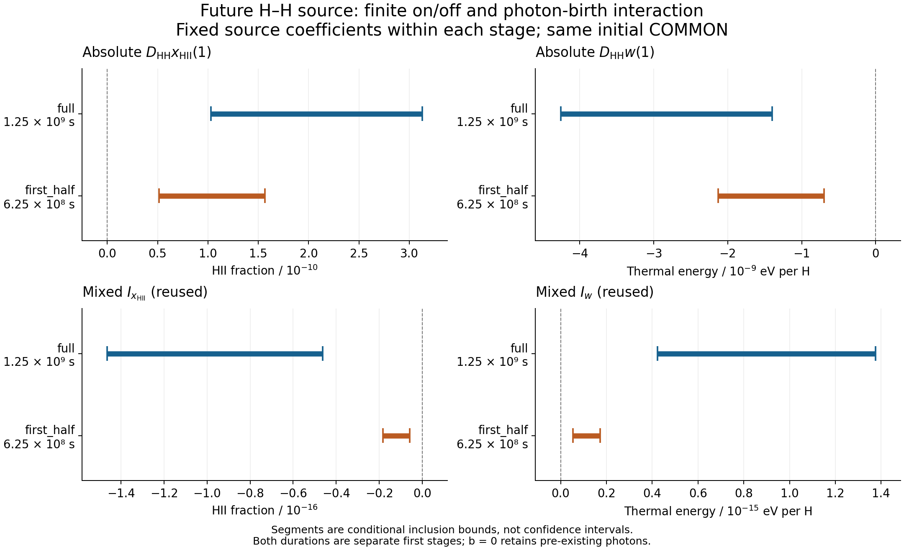

# WU088_HH PHYS12 — HH를 켜고 끈 유한 차이

2026-10-12 · PR45의 관측량 중심 계획 L0–L3 실행

## 핵심 결과

같은 고정 소스 계열에서 미래 HH 항을 켜면 **수소 이온화 분율은 증가하고
기체 열에너지는 감소한다.** 기존의 음의 이온화 혼합 응답은 추가 광자 생성이
이 HH 기여를 줄인다는 뜻이며, HH 자체가 이온화를 줄인다는 뜻이 아니다.
두 결론은 현재 보존된 source-inclusion·동일 고정 계수 C² 계열을 전제로 한다.

새로 수행한 것은 저장된 균일 일차 응답의 **유한 ON/OFF 포함으로의 전환과
정확 유리수 산술 검산**이다. source/root/inverse를 다시 계산하지 않았다.
최종 독립 판정은 review/DECISION.json에 기록한다. 이 문서의 수치와 유도는
그 판정에 제출된 동일 후보이며, 아래에서 원 source 인증과 이번 후처리를 구별한다.

## 1. 무엇을 비교했는가

\[
D_{\rm HH}O(b)=O(\lambda=1,b)-O(\lambda=0,b),
\qquad O\in\{x_{\rm HII},w\},\qquad b=b_{\rm amp}=1.
\]

λ는 COMMON 이후 HH 소스의 강도다. OFF 대조군도 COMMON 이전 HH 이력,
기존 광자 및 장부 보정을 유지한다. b_amp는 미래 photon birth의 강도이며,
b=0에도 기존 광자는 남는다. 같은 비교의 양쪽에는 같은 초기조건과 동일한
고정 계수 묶음 α를 사용한다. 서로 다른 coefficient tuple의 두 해를 빼지 않는다.

x_HII는 n_HII/n_H인 분율, w는 H핵당 **열에너지**다. Δx_HII는 순간
반응률이 아니며, Δw는 HH ON과 OFF의 차이다. w(t+d)−w(t)의 총 변화나
온도 변화로 이름을 바꾸지 않는다.

선택된 LCS 소스는 q=n_H(1−x_HII)²k_LCS(T), H=q(1,0,0,−χ_H)다.
n_H는 proper cm⁻³, k는 cm³/s, χ_H=13.598434599702 eV인 기존 closure를
유지한다. 추가 1/2를 넣지 않는다. frozen107의 singlet H⁺/H⁻ 생성 반응은
별도의 미시 연구 대상이며 이 소스로 대체하거나 동등하게 취급하지 않는다.

## 2. 유한 HH 기여량

표의 끝점은 정확 결과를 포함하도록 바깥쪽으로 반올림했다.
구간은 통계적 신뢰구간이 아니다. 모든 값은 각 stage의 허용된 같은
source/계수 계열에 대한 조건부 포함이다.

| 별개의 첫 단계 | proper duration | D_HH x_HII(1) | D_HH w(1), eV/H |
|---|---:|---:|---:|
| full | 1.25×10⁹ s | [1.02776508, 3.12855435]×10⁻¹⁰ | [−4.25821437, −1.39867706]×10⁻⁹ |
| first_half | 6.25×10⁸ s | [5.14217934×10⁻¹¹, 1.56503922×10⁻¹⁰] | [−2.12917863×10⁻⁹, −6.99525692×10⁻¹⁰] |

두 단계 모두 이온화 기여의 하한이 엄밀히 양수이고 열에너지 차이의 상한이
엄밀히 음수다. full의 경우 HH ON 상태는 OFF보다 이온화 분율이 약
10⁻¹⁰ 크기만큼 높고, H핵당 열에너지는 약 10⁻⁹ eV 크기만큼 낮다.
구간 양 끝이 실제 특정 α에서 달성된다고 주장하지 않는다.

두 duration은 같은 COMMON에서 **각각 출발한 첫 단계**다. 서로의 입력을
이어받지 않았고, duration에 따른 PreBE 계수도 다르다. 따라서 full을
first_half 두 번과 비교한 오차, 시간 수렴률 또는 cosmological history가 아니다.

## 3. 이전 혼합 응답과 모순되지 않는다

PHYS09에서 계산하고 PHYS11이 재사용한 혼합량은

\[
I_O=D_{\rm HH}O(1)-D_{\rm HH}O(0)
\]

다. 아래 표는 이번에 새로 계산한 mixed 결과가 아니라 **기존 값의 재사용**이다.

| 별개의 첫 단계 | I_x_HII | I_w, eV/H |
|---|---:|---:|
| full | [−1.46401541×10⁻¹⁶, −4.62558703×10⁻¹⁷] | [4.23122209×10⁻¹⁶, 1.37612138×10⁻¹⁵] |
| first_half | [−1.83374981×10⁻¹⁷, −5.79831029×10⁻¹⁸] | [5.30061271×10⁻¹⁷, 1.72244131×10⁻¹⁶] |

기존 U는 b∈[0,1] 전체를 포함한다. 따라서 두 표를 결합하면

\[
0<D_{\rm HH}x(1)<D_{\rm HH}x(0),\qquad
D_{\rm HH}w(0)<D_{\rm HH}w(1)<0
\]

이다. 추가 photon birth는 HH가 더 만드는 이온화와 열에너지 감소의 크기를
줄인다. b=0을 전체 photoionization OFF로 해석하면 이 문장이 달라지므로
그 대조군을 혼동하지 않아야 한다.

기존 혼합량이 HH 자체의 크기와 얼마나 다른지 보이기 위해
r_x=−I_x/D_HH x(1), r_w=I_w/[−D_HH w(1)]도 구간으로 평가했다.
분모는 두 경우 모두 **b=1에서의 HH ON/OFF 차이**다.

| 별개의 첫 단계 | r_x | r_w |
|---|---:|---:|
| full | [1.47850621×10⁻⁷, 1.42446502×10⁻⁶] | [9.93661129×10⁻⁸, 9.83873554×10⁻⁷] |
| first_half | [3.70489775×10⁻⁸, 3.56609463×10⁻⁷] | [2.48951058×10⁻⁸, 2.46229885×10⁻⁷] |

full의 이온화 혼합 보정은 이 정의의 HH 효과에 대해 약 0.15–1.42 ppm의
포함범위다. 이는 해당 birth 선택이 HH 응답을 얼마나 바꾸는지에 대한 비교다.
HH를 전체 이온화나 우주론 계산에서 무시해도 된다는 정확도 기준은 아니다.



## 4. 미분 구간이 유한 차이의 답이 되는 이유

같은 α에서 implicit 단계 G(g,λ,b)=g−g_old−dF(g,λ,b)=0를 미분하면

\[
A U=-G_\lambda=dH,\quad A=G_g,\quad U=\partial_\lambda g.
\]

PHYS09가 이미 조건부로 확보한 것은 Θ=[0,1]² 전체에서의 U 포함이다.
미적분학의 기본정리로

\[
D_{\rm HH}O(1)=\int_0^1U_O(\lambda,1)d\lambda.
\]

적분 길이가 1이므로 균일 구간 [U_O] 자체가 finite on/off 결과를 포함한다.
계수 λ에 대한 선형근사로 바꾸지 않았고, 네 corner의 큰 부동소수점 값을
빼서 작은 차이를 얻지 않았다. 원래 포함의 비선형 feedback과 Neumann tail은
그대로 들어 있다. 상세 양화사, 증명, 단위·반례는 theory/FINITE_HH_RESPONSE_KO.md에 있다.

각 고정 α의 branch가 존재하고 C²라는 결론은 원 source-inclusion 및
open-chart 전제와 기존 strict Banach 부등식에 의존한다. 이번 후처리가
원 source kernel의 정확성이나 실제 native root를 새로 인증하지는 않는다.
소스 H의 q>0만으로 결합계의 U_x 부호를 추측하지 않고 실제 포함을 사용했다.

## 5. 실제 검증과 근거 상태

새 과학 산술 실행은 `absolute_v1` 한 번이며 exit code 0이다. 벽시계 시간은
0.064731937 s, CPU user+system은 0.054618 s, 최대 RSS는 15,104 KiB였다.
15개 코드·계약·입력 파일의 실행 전후 identity가 같았다. 이 비용은 이번
후처리 하나의 측정이며 native 성능 또는 NCP 가속률이 아니다.

정확 rational endpoints와 표시 binary64의 bit identity·외향 포함을 확인하고,
단위 길이 FTC 전환과 모든 출력 십진 구간의 외향 포함을 검사했다. 네 가지
의미 검산군은 경쟁반응의 명시적 유리수 해, 비단위/영길이 경로, 다른 α를
섞으면 부호가 바뀌는 반례, 0 포함·0 분모 처리다. 189개의 데이터·산술
assertion을 189개의 독립 물리 테스트로 세지 않는다.

| 주장 | 근거 상태와 범위 |
|---|---|
| 같은 계열의 finite difference = U의 적분 | derived; 고정 α와 C¹ branch 전제 |
| 표의 정확 끝점·부호·비율 포함 | numerically checked, implementation-verified; exact rational 후처리 |
| 원 source inclusion과 C² 계열 | 기존 조건부 연구·독립 판정 재사용; 새 kernel 증명 아님 |
| native solver root·시간 이력·전역 관측량 | unresolved; 이번 실행의 대상 아님 |

새 source evaluation, native root, inverse solve, 과거 과학 suite replay 및
NCP 작업은 모두 0회다. 이전 미계측 카운터를 관측된 0으로 다시 쓰지 않았다.
그림은 저장된 표만 읽어 만들었다. 원 입력과 PHYS11 과학 파일은 변경하지 않았다.

## 6. 오차와 남는 물리적 한계

| 항목 | 이번 처리 |
|---|---|
| 새로운 유리수 전환·비율 산술 오차 | 정확 연산, 0 |
| 표시 반올림 | 별도 외향 십진 끝점과 exact JSON 보존 |
| 기존 포함구간 폭 | 입력·계수 domain, 종속성 손실 및 원 역작용 remainder를 함께 상속; 개별 분해하지 않음 |
| closure·천체물리 차이 | 이번에 탐색하거나 정량화하지 않음 |
| 시간·연속체 오차 | OPEN, 이 단계 길이 비교로 추정하지 않음 |
| 소비 관측량의 허용오차 | 미지정, 생략 가능/불가능 판정을 만들지 않음 |

현재 Hubble triplet은 세 방향 모두 10⁻¹⁴ s⁻¹인 저장 witness다. 이 결과를
임의의 Bianchi 비등방성, 실제 재이온화 전구간 또는 Thomson 광학깊이에
곧바로 일반화하지 않는다. HH_LCS와 별도 microscopic singlet channel을
섞지 않으며 actual native root/U/V/W/I, second_half, 전역 장부 보존,
full49, production의 기존 OPEN 상태를 유지한다.

## 7. 이번 루프의 종료 결정과 재개점

L0의 고정 계열 전제를 연결했고, L1의 절대 HH 응답을 계산했으며,
L2의 표·그림·혼합 응답과의 물리적 구분을 만들었다. L3에서는 이 bounded
질문이 답을 얻었으므로 **추가 구간 정밀화와 NCP 작업을 선정하지 않는다.**
독립 검토가 관련 claim을 채택한 범위만 현재 상태에 기록한다.

`heavy_queue=[]`, `launch=false`, `NO_HEAVY_JOB_READY`를 유지한다.
기존 PHYS11을 다시 돌리거나 빈 queue의 benchmark를 실행하지 않는다.
다음 결과가 특정 소비 관측량을 목표로 하면 그 관측량·domain·절대 오차와
HH 입력을 먼저 연결하고 이 결과를 재사용한다. microscopic HH 연구는
별도 물리 목표와 그 자체의 source/충돌 입력으로 계속할 수 있다.

## 소스와 재현

- 계획: [PR45](https://github.com/cosmosapjw-quantum/WU088_HH/pull/45), commit `78536cbaab84601ba93e62c0d47debc1c5dd2953`.
- PHYS11: [PR44](https://github.com/cosmosapjw-quantum/WU088_HH/pull/44), commit `328372568144c4cdb6cdecd94c9c9bff984e103e`, science subtree `34c49fd710dc89b78e65e021959168139c105fa8`.
- 정확 수치: inputs/phys09/PROJECTED_RESULTS.json의 stages/0,1/U와 W. 원 파일 SHA256 `c6329fed8c411e1592bd1a0c63ebd9ca6151e81500ed1f46fb6b40f4b7758444`.
- 기존 수학·판정: inputs/phys09/PROJECTED_ENERGY_THEOREM_KO.md §§2,5–6 및 DECISION.json.
- 신규 결과: results/absolute_v1/ABSOLUTE_RESULTS.json, OBSERVABLES.csv, SUMMARY.json.
- 실행 증거: evidence/absolute_v1/EXECUTION.json 및 원 stdout/stderr·실행 전후 입력 목록.

독립 재현이 필요한 경우 패키지 root에서 새 경로를 선택해 실행한다.

```bash
python3 code/analyze_absolute_hh.py --out results/independent_reproduction
```

표를 생성한 정확 구간 연산에는 Python 표준 라이브러리만 필요하다.
저장 결과의 그림을 다시 만들 때만 Matplotlib을 사용한다.
