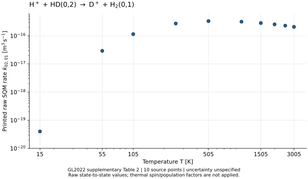

# WU088_HH R18 연구 보고서 — 2026-10-29 KST

원래 GL2022 반응성 supplementary 원자료를 DIGITAL.CSIC 저자 기관 저장소에서 확보했다.
이 자료의 HD(v=0,j=2)→H₂(v′=0,j′=1) SQM 상태율 10개를 정확히 해독하고,
원본 identity·독립 판독·구현·검증을 연결했다. 새 source 하위 노드를 채택해
**DAG 33/48 → 33/49(등록) → 34/49(원자료 하위 노드 완료)**로 진행했다.
상속된 48개 노드 객체는 그대로다. 물리 소비자·중앙 DAG admission 증가는 0이다.

## 원전과 실제 취득

González-Lezana, Hily-Blant, Faure, JCP157,214302(2022), DOI10.1063/5.0128598.
[기관 record](https://digital.csic.es/handle/10261/305186) /
[원본 보충자료](https://digital.csic.es/bitstream/10261/305186/2/h_hd_rate_supplementary_material.pdf) /
[원본 논문](https://digital.csic.es/bitstream/10261/305186/1/A_statistical_investigation.pdf).

보충자료는 HTTP200,273554bytes,SHA256
a65b1cba4208552e7eac6341b462487b23c5afe79f3ba0d2ca009fdee7dd1754이며 14쪽이다.
논문은 HTTP200,4910491bytes,SHA256
5c9d97511c46fa83ddf8e9db0fec0b2fb362f6cca00f58666a63e86a63f25bbc이다.
Publisher ZIP의 이번403도 보존했다. 원자료를 기관 원본으로 확보하여 source-byte 의존성을 해소했다.
Exa·SciSpace는 원전 발견과 서지 확인에 사용했고 수치값은 원본 PDF에서 읽었다.

## 확보한 값

Table2,PDF page6,initial(0,2)행이다. 표의 a(x)는 a×10^(−x)cm³/s다.
아래 값은 인쇄 nominal 값이며 원 계산의 오차 또는 true-rate enclosure는 주어지지 않았다.

| T [K] | 원문 token | nominal k [cm³/s] | nominal k [m³/s] |
|---:|---|---:|---:|
|15|3.99(14)|3.99e-14|3.99e-20|
|55|2.92(11)|2.92e-11|2.92e-17|
|105|1.15(10)|1.15e-10|1.15e-16|
|255|2.74(10)|2.74e-10|2.74e-16|
|505|3.33(10)|3.33e-10|3.33e-16|
|1005|3.18(10)|3.18e-10|3.18e-16|
|1505|2.85(10)|2.85e-10|2.85e-16|
|2005|2.55(10)|2.55e-10|2.55e-16|
|2505|2.30(10)|2.30e-10|2.30e-16|
|3005|2.08(10)|2.08e-10|2.08e-16|

원문 열평균의 홀수 최종준위 계수3/4와 초기 population p₂(T)는 이 raw table에 적용되지 않았다.
사용할 때 source-defined thermal 연산에서 별도로 한 번 적용한다.
본 논문 Eq5의 initialj0..8과 보충자료의 initialj0..6은 다르며 이 차이는 미해결로 보존했다.
선택 j2행에는 영향을 주지 않는다. j7/8을 채우거나 Table11을 본문 total과 동일시하지 않았다.

## 이론에서 코드까지

a=A/10^d인 유한 인쇄 소수일 때 k_print=A/10^(d+x)cm³/s,
SI 값은 A/10^(d+x+6)m³/s다. Fraction 정수 연산으로 해독해 부동소수점 오차를 도입하지 않는다.
ν=(−1,−1,1,1)의 H핵수·D핵수·전하 보존을 직접 유도했다.
실제 상태밀도와 시간이 주어진다면 J=k n_H⁺ n_HD(02),dot(n)=νJ다.
density·clock·에너지 Q와 원자료가 주지 않은 연속온도 모형은 이번 소스 출력에 들어 있지 않다.

src/native_rates.py는 원본 PDF의 크기·SHA를 먼저 확인하고 **검증한 바로 그 바이트**를
pdftotext stdin으로 전달한다. Table2 캡션·온도 순서·initial row·token을 검사한다.
원본 검증을 통과한 loader만 NativeGrid를 발급하며 임의 synthetic 생성자를 통한 source 표지는 거절한다.
조회는 공급된 10개 온도와 선택 상태·SQM 방법에 한정한다.
CLI JSON은 exclusive-create이며 기존 출력 파일을 덮어쓰지 않는다.

## 실제 검증과 교정

| 검증 | 결과와 범위 |
|---|---|
|원본 독립 판독|작성자 extraction을 보기 전 별도 agent가 원 PDF·Table2 10cells 판독, PASS|
|최종 primary|19/19; 실제 원본·단위·상태/온도·provenance·CLI·오류 경로|
|별도 reference|pypdf+Decimal+정수 교차곱10/10; production import0|
|Wolfram|정확한 잔차15/15가0, 양성성 True|
|비저자 C9|최종53 targeted checks PASS, 실제 mutable-path 교체 probe PASS, 중대 지적0|
|코드 identity|Git blob be2a845263b215b604f255ffe5deabe55be9dd7b, 원격 S08 원문과 일치|
|그림|원자료10점 PNG/SVG 생성·실제 시각 검토 PASS; 보간선·임의 오차막대0|

C9에서 발견한 원본 표지 생성자 결함과 hash 후 파일 경로 재개방 문제를 실제로 교정했다.
초기17/17 및 중간18/18 검사와 당시 결함의 반례·코드·로그를 따로 보존했다.
최종19/19는 교정된 최종 코드에 대한 결과다. 기존 R16/R17A/R17B suite와 물리 ODE 재실행은0이다.

R17A의 일반 비식별성 명제에 K>0 조건을 추가하고 K=0의 유일한0해를 별도로 명시했다.
기존 양의 두 총율 계산은 유지된다. 별도 비저자 검토를 결속한 R17A/R17B closure overlay는
각각20/20이며 frozen 원본 기록을 바꾸지 않았다. 이번 연구의 새 strong no-go는 없다.

Python CPU값은 process_time으로 측정한 자기 프로세스 CPU다.
Poppler child·원격 CAS CPU와 전체 역사 CPU는 별도로 측정하지 않았다.
이번 실행 명령·wall·검증 출력과 두 번의 진단에 따른 교정 범위는 EXECUTION_LEDGER.json에 있다.

## 최신 자료 대조와 남은 연결

접근 가능한51repo metadata와2476branch 이름을 terminal까지 대조했다.
공개35repo의1985heads는 SHA/ref를 직접 열거했고 private16repo의491개는 connector 이름 목록까지다.
갱신된 PR목록과 관련13PR·실제파일23개를 확인했고23/23 원격 Git blob이 일치했다.
Private 이름/내용은 공개 팩에서 제외했다. 다른 대화는 현재 PersonalContext 반환 범위만 읽었으며
전체 다른 대화의 완전 열거 API는 없었다. 상세 coverage와 정확한 owner HEAD는 authority/에 있다.

REC의 현재 함수는50/100/200K,REI 저장 이력은300K를 쓴다.
이번 원자료10개 온도와 교집합은0이고 REI17state에는HD/H₂가 없다.
이것은 특정 현재 입력의 domain mismatch다. 다음 구현은 온도·상태·density·clock을 명시한
소비자 연결이며 NEXT_INPUT_CONTRACT.json이 정확한 의무와 고정T nominal 반응계 예제를 준다.
명목 source 기반의 유한 모델 검증과 source 불확실성까지 포함하는 물리 오차 인증을 구별한다.

## 저장·게시

독립 branch research/wu-hd-source-bound-r18-20261029, DraftPR155다.
S01–S10은 Ri/Ci를 같은 번호로 묶어 source commit과 단계별 원본 ZIP을 발행한다.
실제 provider ACK·크기·해시는 delivery/PUBLICATION_INDEX.json의 발행 후 영수증에 있다.
S01은 취득 전 계약이며 S02 이후 ZIP은 원래 논문·보충자료 PDF도 포함한다.
각 ZIP은 로컬 CRC와 모든 member SHA를 검사했다. Provider 원본 복원은 실제 수행한 대상만 별도 기록한다.
현재 archive 자신의 영수증은 그 archive 밖에 두어 자기 identity의 순환을 만들지 않는다.

이론 R1–R10/코딩 C1–C10은20/20 scoped 종결한다.
원래48node 결과를 보존한 sourceDAG는34/49이며
HH_R10=OFF,production=NOT_ISSUED,L4=false,physical/centraldelta0을 유지한다.

## 최종 전달 확인

S01–S10 원본 ZIP10개와 provider실제ACK20개가 완료되었다.
S10 source는2b9c2babde0a052ce4c3147664613a1f7ef83de1이다.
S10 ZIP5394406bytes,SHA25680d1728dc849c576d3106238d138ea6aec0fc1eeb8206be998d179ac8b3d9f73를
Drive·Dropbox에서 각각 실제HTTP200으로 내려받았고 CRC와99개source-member SHA가 모두 일치했다.
과학suite를 재실행하지 않았다. 다른9단계의 provider원본GET은수행하지 않았으며 ACK/size와local검사를 보존한다.
첫S10Dropbox전송실패는 대상NOT_FOUND 확인 후 동일경로 재전송으로 해소했다.
최종receipt/restore/index는 S10과학source 이후 별도metadata commit으로 게시한다.

